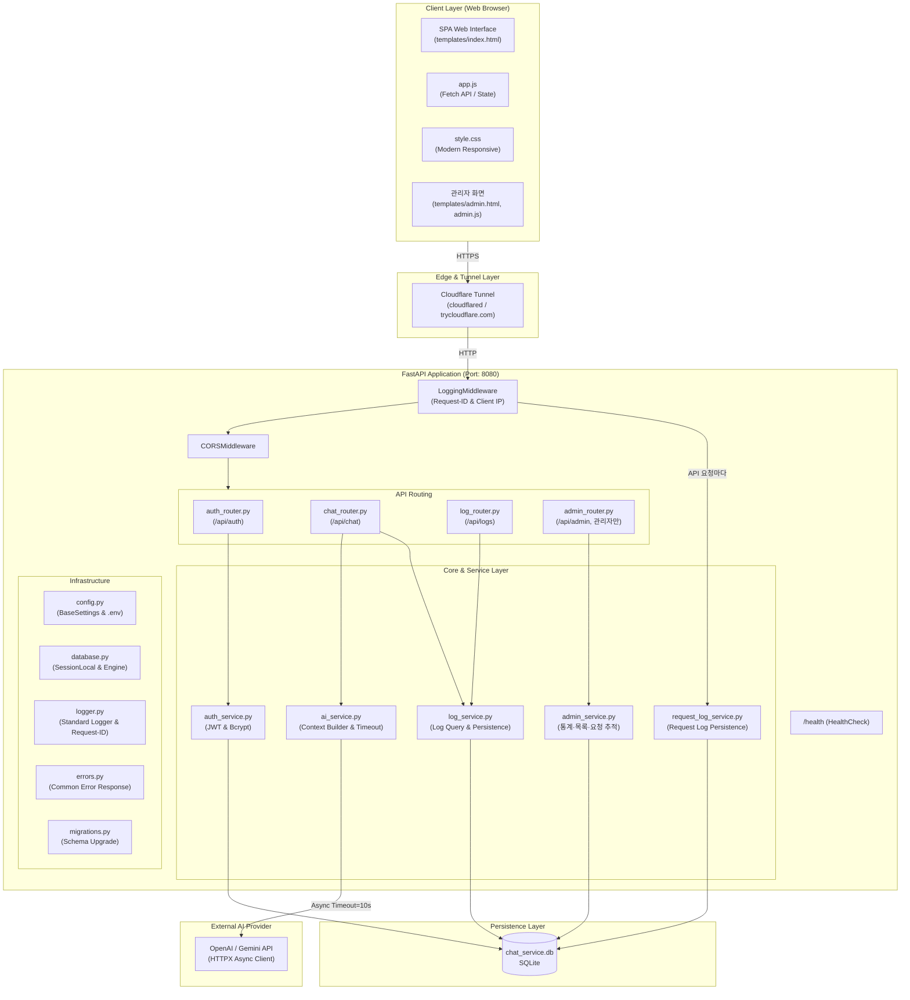
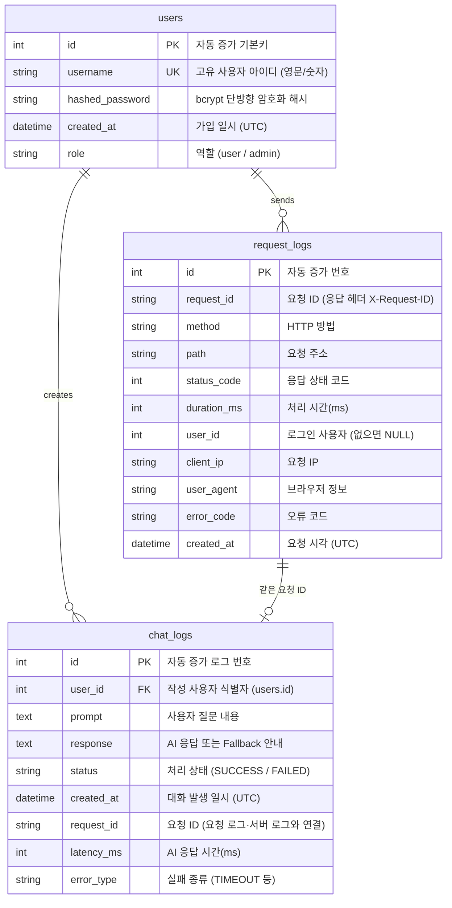

# 🌐 Codyssey B7-1 지능형 웹 AI 챗봇 서비스

> **FastAPI**, **SQLite**, **AI API 파이프라인**, **반응형 웹 UI**를 유기적으로 통합하고, 외부 접속 가능한 클라우드 환경에 안전하게 배포한 올인원 AI 챗봇 웹 애플리케이션입니다.

---

## 🔗 1. 외부 접속 서비스 URL

평가자 및 외부 네트워크 사용자를 위해 상시 접속 가능한 퍼블릭 도메인을 제공합니다.

* **🌐 서비스 접속 URL**: [https://undertaken-resume-anywhere-overall.trycloudflare.com](https://undertaken-resume-anywhere-overall.trycloudflare.com)
* **📋 Swagger API 명세서**: [https://undertaken-resume-anywhere-overall.trycloudflare.com/docs](https://undertaken-resume-anywhere-overall.trycloudflare.com/docs)
* **🔍 상태 점검 (Health Check)**: [https://undertaken-resume-anywhere-overall.trycloudflare.com/health](https://undertaken-resume-anywhere-overall.trycloudflare.com/health)
* **🛠️ 운영 관리자 화면**: [https://undertaken-resume-anywhere-overall.trycloudflare.com/admin](https://undertaken-resume-anywhere-overall.trycloudflare.com/admin) (기본 관리자 계정 `admin` / `1234`, 6장 "관리자 계정" 참고)

> **💡 배포 안내**:
> 로컬 서버 구동 후 `scripts/run_tunnel.sh` (또는 Windows의 `scripts\run_tunnel.ps1`)를 실행하면 Cloudflare Tunnel을 통해 즉시 외부 접속이 가능하며, Render/PaaS 배포용 `Procfile`도 함께 제공됩니다.

---

## 📖 2. 프로젝트 개요

### 1) 문제 정의 (Problem Definition)
기존의 간단한 챗봇 튜토리얼은 프론트엔드에서 API Key를 노출하거나, 사용자의 과거 대화 문맥(Context)을 기억하지 못해 일회성 질문에 그치는 한계가 있었습니다. 또한 네트워크 지연이나 외부 AI API 장애 발생 시 서버 프로세스 자체가 비정상 종료(Crash)되거나, 대화 내역이 유실되어 사후 감사 및 분석이 불가능한 문제가 있었습니다.

### 2) 타겟 사용자 (Target Audience)
* 일관된 대화 문맥을 유지하며 신뢰성 있는 AI 어시스턴트 서비스를 이용하고자 하는 일반 사용자
* 사용자별 대화 로그를 추적 및 감사하고 시스템 안정성을 실시간 모니터링해야 하는 서비스 운영자 및 평가자

### 3) 핵심 사용자 시나리오 (Key Scenarios)
1. **회원가입 및 로그인**: 사용자는 안전한 비밀번호 단방향 해싱(bcrypt)을 통해 계정을 생성하고, JWT Bearer 토큰을 발급받아 세션을 수립합니다. (비로그인 사용자는 챗봇 입력이 비활성화됩니다.)
2. **문맥 기반 실시간 대화**: 사용자가 질문을 전송하면 백엔드 서버가 최근 직전 3개의 성공 대화 이력을 프롬프트에 자동으로 조합하여 AI 모델(OpenAI / Gemini)에 비동기 전달하고, 같은 화면의 말풍선에 답변을 출력합니다. (답변을 다 받은 뒤 한 번에 표시하고, 기다리는 동안 로딩 애니메이션을 보여줍니다.)
3. **대화 이력 영속화 및 추적**: 모든 질의응답은 사용자 식별자, 생성 일시, 성공/실패 상태코드와 함께 SQLite에 안전하게 기록되며, 사용자는 사이드바 또는 API(`GET /api/logs/me`)를 통해 본인의 대화 이력을 언제든지 다시 조회할 수 있습니다.
4. **장애 방어 및 운영 추적**: 외부 AI API가 지연되거나 실패해도 서버는 멈추지 않고, 원인에 맞는 상태 코드(타임아웃 504, AI 오류 502, AI 미설정 503)와 안내 문구를 반환합니다. 모든 API 요청은 요청 로그(DB `request_logs`)에 남고, 같은 요청 ID가 응답 헤더·서버 로그(`[요청 수신]`, `[AI 호출]`, `[AI 응답]`, `[DB 저장]`)·대화 로그에 함께 기록되어 문제가 생긴 요청을 끝까지 추적할 수 있습니다.
5. **운영 관리자 화면**: 운영자는 관리자 계정으로 `/admin`에 로그인해 서비스 상태(헬스체크, 최근 24시간 요청 수·5xx 오류율·응답 시간, 대화 실패율과 실패 종류), 요청 로그, 대화 로그를 화면에서 조회하고, 요청 ID 하나로 요청 로그·대화 로그·서버 로그를 이어서 봅니다. 관리자 권한은 사용자 역할(`role`)로 관리하며, 일반 사용자는 관리자 API에서 `403`으로 막힙니다.

---

## 🏗️ 3. 시스템 아키텍처 및 컴포넌트 역할



### 🧩 주요 컴포넌트 역할
* **FastAPI 메인 앱 (`app/main.py`)**: 라우터 등록, 정적 파일(/static) 서빙, 수명주기(Lifespan) 관리 및 DB 테이블 자동 점검
* **인프라 & 로깅 (`app/core/`)**:
  * `config.py`: Pydantic BaseSettings 기반의 안전한 환경 변수 관리 (민감정보 은닉)
  * `database.py`: SQLAlchemy 기반 SQLite 세션 제너레이터(`get_db`) 제공
  * `logger.py`: 고유 `Request-ID` 부여, 역방향 프록시(`X-Forwarded-For`) 클라이언트 IP 추출, `[요청 수신]` 이벤트 자동 기록, 모든 로그 줄에 `[요청 ID]` 표시, API 요청을 요청 로그(DB)에 저장
  * `errors.py`: 모든 오류를 `{detail, code, request_id}` 공통 형식으로 응답 (422 한국어 안내, 500 내부 정보 숨김)
  * `migrations.py`: 이전 버전으로 만든 DB에 새 컬럼을 서버 시작 때 자동 추가
* **인증 & 보안 (`app/api/auth_router.py`, `app/services/auth_service.py`)**:
  * bcrypt 비밀번호 암호화, JWT Access Token 발급 및 검증
  * `get_current_user` 의존성을 통한 비인가 401 Unauthorized 사전 차단
* **AI 파이프라인 (`app/api/chat_router.py`, `app/services/ai_service.py`)**:
  * 사용자 질문 유효성 검사 (공백/길이 제한)
  * 최근 N개 대화 컨텍스트 조립 (`build_chat_context`)
  * 타임아웃(10초) 방어 및 비정상 종료(500) 원천 방지 Fallback 응답
* **대화 로그 & UI (`app/api/log_router.py`, `app/services/log_service.py`, `static/`, `templates/`)**:
  * 대화 로그 누적 저장 및 내 대화 이력 조회 API 제공
  * 요청 로그 저장 (`app/services/request_log_service.py`, `request_logs` 테이블)
  * 모던 모바일 반응형 챗봇 SPA 화면 구성
* **관리자 기능 (`app/api/admin_router.py`, `app/services/admin_service.py`, `templates/admin.html`, `static/js/admin.js`)**:
  * 사용자 역할(`users.role`: `user` / `admin`)과 관리자 권한 검사(`get_current_admin`, 일반 사용자 `403 ADMIN_REQUIRED`)
  * 관리자 API: 서비스 상태 요약, 요청 로그·대화 로그 조회, 요청 ID 추적
  * 운영 관리자 화면(`/admin`)과 관리자 지정 스크립트(`scripts/create_admin.py`)

---

## 🗄️ 4. 데이터베이스 구조 (DB Schema & ERD)

SQLite 기반으로 동작하며, 외래키(`user_id`)를 통해 사용자와 대화 로그 간 1:N 관계를 유지합니다.



### 테이블 상세 명세

#### 1) `users` 테이블 (회원 정보)
| 컬럼명 | 데이터 타입 | 제약 조건 | 설명 |
| :--- | :--- | :--- | :--- |
| `id` | INTEGER | PRIMARY KEY, AUTOINCREMENT | 사용자 고유 식별 번호 |
| `username` | VARCHAR(50) | UNIQUE, INDEX, NOT NULL | 사용자 로그인 아이디 (영문·숫자 3~50자) |
| `hashed_password` | VARCHAR(255) | NOT NULL | bcrypt 단방향 해싱된 비밀번호 |
| `created_at` | DATETIME | DEFAULT utcnow | 계정 생성 일시 |
| `role` | VARCHAR(20) | NOT NULL, DEFAULT 'user' | 사용자 역할: `user`(일반) 또는 `admin`(관리자). 관리자는 `scripts/create_admin.py`로만 지정 |

#### 2) `chat_logs` 테이블 (대화 로그)
| 컬럼명 | 데이터 타입 | 제약 조건 | 설명 |
| :--- | :--- | :--- | :--- |
| `id` | INTEGER | PRIMARY KEY, AUTOINCREMENT | 대화 로그 고유 식별 번호 |
| `user_id` | INTEGER | FOREIGN KEY (`users.id`), NOT NULL | 질문 작성 사용자 ID |
| `prompt` | TEXT | NOT NULL | 사용자 입력 질문 (공백 제거 후 최대 1,000자) |
| `response` | TEXT | NOT NULL | AI 응답 텍스트 또는 장애 발생 시 Fallback 문구 |
| `status` | VARCHAR(20) | NOT NULL, DEFAULT 'SUCCESS' | AI 호출 처리 상태 (`SUCCESS` 또는 `FAILED`) |
| `created_at` | DATETIME | NOT NULL, DEFAULT utc_now, INDEX | 대화 저장 시각 (UTC, 최신순 정렬용) |
| `request_id` | VARCHAR(16) | NULL 허용, INDEX | 요청 ID. 요청 로그·서버 로그에서 같은 값으로 찾을 수 있음 |
| `latency_ms` | INTEGER | NULL 허용 | AI 응답까지 걸린 시간(ms) |
| `error_type` | VARCHAR(30) | NULL 허용 | 실패 종류: `TIMEOUT`, `UPSTREAM_ERROR`, `BAD_RESPONSE`, `CONNECTION_ERROR`, `UNEXPECTED_ERROR`, `NOT_CONFIGURED` (성공이면 NULL) |

#### 3) `request_logs` 테이블 (요청 로그)
모든 API 요청(`/api/...`)을 한 줄씩 기록합니다. 화면·정적 파일·헬스체크 요청은 양이 많아 제외합니다.

| 컬럼명 | 데이터 타입 | 제약 조건 | 설명 |
| :--- | :--- | :--- | :--- |
| `id` | INTEGER | PRIMARY KEY | 요청 로그 번호 |
| `request_id` | VARCHAR(16) | NOT NULL, INDEX | 요청 ID (응답 헤더 `X-Request-ID`, 오류 응답의 `request_id`와 같은 값) |
| `method` | VARCHAR(10) | NOT NULL | HTTP 방법 (GET, POST 등) |
| `path` | VARCHAR(255) | NOT NULL, INDEX | 요청 주소 (쿼리 문자열 제외) |
| `status_code` | INTEGER | NOT NULL, INDEX | 응답 상태 코드 |
| `duration_ms` | INTEGER | NOT NULL | 요청을 받고 응답할 때까지 걸린 시간(ms) |
| `user_id` | INTEGER | NULL 허용, INDEX | 로그인한 사용자 번호 (사용자가 지워져도 기록이 남도록 외래키는 걸지 않음) |
| `client_ip` | VARCHAR(64) | NULL 허용 | 요청 IP (터널·프록시 환경은 `X-Forwarded-For` 우선) |
| `user_agent` | VARCHAR(255) | NULL 허용 | 브라우저·클라이언트 정보 |
| `error_code` | VARCHAR(50) | NULL 허용 | 오류 응답의 `code` (예: `AUTH_REQUIRED`, `AI_TIMEOUT`) |
| `created_at` | DATETIME | NOT NULL, INDEX | 요청 시각 (UTC) |

### 스키마 변경(마이그레이션) 절차
`Base.metadata.create_all`은 없는 테이블만 만들고, 이미 있는 테이블에 새 컬럼을 추가하지 않습니다. 그래서 서버가 시작할 때 `app/core/migrations.py`의 `upgrade_schema`가 이전 버전 DB에 빠진 컬럼과 인덱스를 `ALTER TABLE`로 추가합니다. 기존 기록은 그대로 두고, 여러 번 실행해도 안전합니다.

1. 운영 중인 DB 파일(`chat_service.db`)을 먼저 복사해 백업합니다.
2. 모델(`app/models/*.py`)에 컬럼을 추가하고, 같은 컬럼을 `app/core/migrations.py`의 `ADDED_COLUMNS`에 적습니다. 새 컬럼은 기존 행에 영향이 없도록 NULL을 허용하거나 기본값을 둡니다.
3. 서버를 다시 시작하면 서버 로그에 `[DB 마이그레이션] 컬럼 추가: 테이블.컬럼`이 남습니다.
4. `python scripts/verify_logs.py`나 `sqlite3`로 기존 기록이 그대로인지 확인합니다.

이번 버전에서 자동으로 추가되는 컬럼은 `chat_logs.request_id`·`latency_ms`·`error_type`과 `users.role`이며, 기존 사용자는 모두 일반 사용자(`user`)가 됩니다.

컬럼 이름 변경·삭제처럼 복잡한 변경이 생기면 변경 이력을 관리하는 Alembic 도입을 권장합니다.

---

## 📡 5. API 명세서 (API Specification)

모든 API는 대화형 인터랙티브 문서(Swagger UI: `/docs`, ReDoc: `/redoc`)에서도 실시간 테스트 가능합니다.

### 공통 오류 응답 형식
모든 오류는 같은 형식으로 응답합니다 (`app/core/errors.py`).

```json
{
  "detail": "로그인이 필요한 서비스입니다.",
  "code": "AUTH_REQUIRED",
  "request_id": "3f9a1c2b"
}
```
* `detail`: 사용자에게 보여줄 한국어 안내
* `code`: 오류 종류를 프로그램이 구분하는 값
* `request_id`: 응답 헤더 `X-Request-ID`, 서버 로그, 요청 로그와 같은 값이라 문의·장애 추적에 사용
* 입력 검증 오류(422)는 항목별 안내가 담긴 `errors`가 추가되고, 입력한 값(비밀번호 등)은 응답에 다시 싣지 않습니다.

| 상태 코드 | code | 발생 상황 | 예시 detail |
| :---: | :--- | :--- | :--- |
| 401 | `AUTH_REQUIRED` | 토큰 없음·잘못된 토큰·만료 | 로그인이 필요한 서비스입니다. |
| 401 | `INVALID_CREDENTIALS` | 로그인 실패 | 아이디 또는 비밀번호가 올바르지 않습니다. |
| 403 | `ADMIN_REQUIRED` | 일반 사용자가 관리자 API 요청 | 관리자만 사용할 수 있는 기능입니다. |
| 404 | `NOT_FOUND` | 없는 주소 | 요청한 주소를 찾을 수 없습니다. |
| 404 | `REQUEST_NOT_FOUND` | 요청 추적에서 기록이 없는 요청 ID | 해당 요청 ID의 기록이 없습니다. |
| 405 | `METHOD_NOT_ALLOWED` | 허용되지 않은 방식 (예: 채팅을 GET으로) | 허용되지 않은 요청 방식입니다. |
| 409 | `USERNAME_TAKEN` | 아이디 중복 | 이미 존재하는 아이디입니다. |
| 422 | `VALIDATION_ERROR` | 입력 형식 오류 (길이·아이디 규칙·JSON 형식·조회 개수 범위) | 아이디는 3자 이상이어야 합니다. |
| 422 | `PROMPT_INVALID` | 공백만 있는 질문 | 질문 내용이 비어 있습니다. 텍스트를 입력해주세요. |
| 500 | `INTERNAL_ERROR` | 예상하지 못한 서버 오류 (내부 정보는 숨김) | 서버 내부 오류가 발생했습니다. 잠시 후 다시 시도해주세요. |
| 502 | `AI_UPSTREAM_ERROR` · `AI_BAD_RESPONSE` · `AI_CONNECTION_ERROR` · `AI_UNEXPECTED_ERROR` | AI 서버 오류 응답 · 빈 답변·다른 형식 · 연결 실패 · 그 밖의 예외 | 현재 AI 서비스가 원활하지 않습니다. 잠시 후 다시 시도해주세요. |
| 503 | `AI_NOT_CONFIGURED` | 서버에 AI 키가 설정되지 않음 | 현재 AI 서비스가 원활하지 않습니다. 잠시 후 다시 시도해주세요. |
| 504 | `AI_TIMEOUT` | AI 응답 시간 초과 (기본 10초) | AI 응답 시간이 초과되었습니다. 잠시 후 다시 질문해주세요. |

### 공개 API와 로그인이 필요한 API
| 구분 | API |
| :--- | :--- |
| 공개 | `GET /health`, `POST /api/auth/register`, `POST /api/auth/login`, `POST /api/auth/logout` |
| 로그인 필요 (`Authorization: Bearer <토큰>`) | `GET /api/auth/me`, `POST /api/chat`, `GET /api/logs/me` |
| 관리자 전용 (관리자 계정의 `Bearer <토큰>`) | `GET /api/admin/summary`, `GET /api/admin/requests`, `GET /api/admin/requests/{request_id}`, `GET /api/admin/chat-logs` |
| 화면 | `GET /` (챗봇), `GET /admin` (관리자 화면: 화면 파일에는 데이터가 없고, 데이터는 관리자 API가 관리자 계정인지 확인한 뒤에만 보냄) |

* **인증(401)과 권한(403)**: 토큰이 없거나 잘못되면 `401 AUTH_REQUIRED`, 로그인했지만 관리자가 아니면 `403 ADMIN_REQUIRED`입니다.
* 역할은 토큰에 넣지 않고 요청마다 DB에서 확인하므로, 관리자 권한을 해제하면 같은 토큰이라도 다음 요청부터 바로 막힙니다.

### 1) 시스템 헬스체크
* **엔드포인트**: `GET /health`
* **설명**: 서버 기동 상태와 DB 연결을 실제로 확인합니다 (`SELECT 1`). DB에 문제가 있으면 `503`을 돌려줘 외부 모니터링(Cloudflare Health Check, UptimeRobot 등)이 장애를 알아챌 수 있습니다.
* **응답 예시 (`200 OK`)**:
  ```json
  {
    "status": "healthy",
    "project": "Codyssey B7-1 AI Chatbot",
    "version": "1.1.0",
    "uptime_seconds": 3600,
    "checked_at": "2026-10-31T09:12:14Z",
    "database": {"status": "ok", "file": "./chat_service.db"},
    "ai": {"configured": true}
  }
  ```
* **DB 장애 시 (`503 Service Unavailable`)**: `"status": "unhealthy"`, `"database": {"status": "error", ...}`
* `ai.configured`는 AI 키가 설정됐는지만 알려 주고, 키 값은 보내지 않습니다.

---

### 2) 사용자 인증 (Auth)

#### ① 회원가입 (`POST /api/auth/register`)
* **요청 본문 (JSON)**:
  ```json
  {
    "username": "user123",
    "password": "Password123!"
  }
  ```
* **성공 응답 (`201 Created`)**:
  ```json
  {
    "message": "회원가입이 완료되었습니다."
  }
  ```
* **실패 응답**:
  * `409 Conflict` (`USERNAME_TAKEN`): 이미 사용 중인 아이디
  * `422 Unprocessable Entity` (`VALIDATION_ERROR`): 아이디 규칙(영문·숫자 3~50자) 또는 비밀번호(4~100자, 공백만 불가) 위반
  ```json
  {
    "detail": "아이디는 3자 이상이어야 합니다.\n비밀번호는 4자 이상이어야 합니다.",
    "code": "VALIDATION_ERROR",
    "request_id": "8c1d2e3f",
    "errors": [
      {"field": "username", "message": "아이디는 3자 이상이어야 합니다."},
      {"field": "password", "message": "비밀번호는 4자 이상이어야 합니다."}
    ]
  }
  ```

#### ② 로그인 (`POST /api/auth/login`)
* **요청 본문 (JSON)**:
  ```json
  {
    "username": "user123",
    "password": "Password123!"
  }
  ```
* **성공 응답 (`200 OK`)**:
  ```json
  {
    "access_token": "eyJhbGciOiJIUzI1NiIsInR5cCI6IkpXVCJ9...",
    "token_type": "bearer",
    "user": {
      "id": 1,
      "username": "user123",
      "role": "user"
    }
  }
  ```
* **실패 응답 (`401 Unauthorized`)**:
  ```json
  {
    "detail": "아이디 또는 비밀번호가 올바르지 않습니다.",
    "code": "INVALID_CREDENTIALS",
    "request_id": "a1b2c3d4"
  }
  ```

#### ③ 내 계정 정보 확인 (`GET /api/auth/me`)
* **인증 헤더**: `Authorization: Bearer <access_token>` 필수
* **성공 응답 (`200 OK`)**: `role`은 `user` 또는 `admin` (웹 화면은 관리자에게만 관리자 화면 링크를 보여줌)
  ```json
  {
    "id": 1,
    "username": "user123",
    "role": "user"
  }
  ```

---

### 3) AI 챗봇 (Chat)

#### 질문 전송 및 답변 수신 (`POST /api/chat`)
* **인증 헤더**: `Authorization: Bearer <access_token>` 필수 (미인증 시 `401 Unauthorized` 차단)
* **요청 본문 (JSON)**:
  ```json
  {
    "prompt": "FastAPI에서 비동기 처리가 왜 효율적인가요?"
  }
  ```
* **성공 응답 (`200 OK`)**:
  ```json
  {
    "prompt": "FastAPI에서 비동기 처리가 왜 효율적인가요?",
    "response": "FastAPI는 Python의 asyncio와 Starlette 기반의 이벤트 루프를 활용하여 I/O 바운드 작업 시 스레드 블로킹 없이 높은 동시성을 처리할 수 있기 때문입니다.",
    "status": "SUCCESS",
    "context_used_count": 2
  }
  ```
* **AI 장애 시 응답 (`504` 타임아웃 · `502` AI 오류 · `503` AI 키 미설정)**: 서버는 멈추지 않고, 공통 오류 형식에 대화 정보를 더해 응답합니다. 대화는 `status="FAILED"`와 실패 종류(`error_type`)로 DB에 저장되고, 화면은 `response`를 빨간 말풍선으로 보여줍니다.
  ```json
  {
    "detail": "AI 응답 시간이 초과되었습니다. 잠시 후 다시 질문해주세요.",
    "code": "AI_TIMEOUT",
    "request_id": "e7f2bc01",
    "prompt": "FastAPI에서 비동기 처리가 왜 효율적인가요?",
    "response": "AI 응답 시간이 초과되었습니다. 잠시 후 다시 질문해주세요.",
    "status": "FAILED",
    "context_used_count": 2
  }
  ```
* **입력 유효성 검사 실패 (`422 Unprocessable Entity`)**: 빈 문자열이나 1,000자 초과는 `VALIDATION_ERROR`, 공백만 있는 질문은 `PROMPT_INVALID`로 AI를 호출하기 전에 막습니다.
  ```json
  {"detail": "질문 내용이 비어 있습니다. 텍스트를 입력해주세요.", "code": "PROMPT_INVALID", "request_id": "5d6e7f80"}
  ```
* `context_used_count`는 실제로 AI에 함께 보낸 이전 대화 수입니다 (실패한 대화는 빠짐).

---

### 4) 대화 로그 조회 (Logs)

#### ① 내 대화 이력 조회 (`GET /api/logs/me`)
* **인증 헤더**: `Authorization: Bearer <access_token>`
* **쿼리 파라미터**: `limit` (기본값 100, 최대 500)
* **성공 응답 (`200 OK`)**:
  ```json
  [
    {
      "id": 15,
      "user_id": 1,
      "prompt": "FastAPI에서 비동기 처리가 왜 효율적인가요?",
      "response": "FastAPI는 Python의 asyncio...",
      "status": "SUCCESS",
      "created_at": "2026-10-23T14:30:00"
    }
  ]
  ```

전체 사용자의 대화 로그는 아래 관리자 API(`GET /api/admin/chat-logs`)로 조회합니다. (이전의 관리자 키 방식 `GET /api/logs/admin`은 관리자 계정 방식으로 바뀌며 없어졌습니다.)

---

### 5) 관리자 API (Admin)
모든 관리자 API는 관리자 계정으로 로그인한 토큰(`Authorization: Bearer <access_token>`)이 필요합니다. 토큰이 없으면 `401 AUTH_REQUIRED`, 일반 사용자면 `403 ADMIN_REQUIRED`입니다. 시각은 다른 API와 같이 UTC로 보내고, 관리자 화면이 한국 시간으로 바꿔 보여줍니다.

#### ① 서비스 상태 요약 (`GET /api/admin/summary`)
사용자 수, 대화 성공·실패와 실패 종류, 최근 24시간 요청 통계, 최근 오류 요청을 한 번에 돌려줍니다.
```json
{
  "generated_at": "2026-10-31T09:55:54.134228",
  "users": {"total": 3, "admins": 1, "new_24h": 3},
  "chats": {
    "total": 7,
    "success": 5,
    "failed": 2,
    "failure_rate": 28.6,
    "last_24h": 7,
    "failed_24h": 2,
    "avg_latency_ms_24h": 1820,
    "failures_by_type": [
      {"code": "TIMEOUT", "count": 1},
      {"code": "UPSTREAM_ERROR", "count": 1}
    ]
  },
  "requests": {
    "window_hours": 24,
    "total": 119,
    "status_2xx": 108,
    "status_4xx": 9,
    "status_5xx": 2,
    "server_error_rate": 1.7,
    "avg_duration_ms": 45,
    "p95_duration_ms": 222,
    "top_error_codes": [
      {"code": "AUTH_REQUIRED", "count": 2},
      {"code": "INVALID_CREDENTIALS", "count": 2},
      {"code": "AI_TIMEOUT", "count": 1}
    ]
  },
  "recent_errors": [
    {
      "id": 11,
      "request_id": "e7f2bc01",
      "method": "POST",
      "path": "/api/chat",
      "status_code": 504,
      "duration_ms": 10021,
      "user_id": 1,
      "username": "alice1",
      "client_ip": "127.0.0.1",
      "user_agent": "Mozilla/5.0 ...",
      "error_code": "AI_TIMEOUT",
      "created_at": "2026-10-31T09:50:54.375086"
    }
  ]
}
```
* `p95_duration_ms`: 요청을 응답 시간 순으로 줄 세웠을 때 95% 위치의 값 (요청 95%가 이 시간 안에 끝남)
* 실패 종류를 기록하기 전(이전 버전)에 쌓인 실패는 `UNKNOWN`으로 묶습니다.

#### ② 요청 로그 목록 (`GET /api/admin/requests`)
| 쿼리 파라미터 | 설명 |
| :--- | :--- |
| `skip`, `limit` | 페이지 (기본 0, 50 / 최대 200) |
| `status` | `all`(기본), `2xx`, `4xx`, `5xx`, `errors`(4xx와 5xx) |
| `since_hours` | 최근 몇 시간 동안의 요청만 (1~2160, 예: `24`) |
| `path` | 주소에 이 글자가 들어간 요청만 (예: `/api/chat`) |
| `username` | 이 사용자가 보낸 요청만 |
| `error_code` | 이 오류 코드가 난 요청만 (예: `AI_TIMEOUT`) |
| `min_duration_ms` | 응답 시간이 이 값 이상인 느린 요청만 |
| `exclude_admin` | `true`면 관리자 화면이 보낸 요청(`/api/admin`)을 뺌 |

응답은 `{"total": 조건에 맞는 전체 건수, "skip": 0, "limit": 50, "items": [요청 로그 + username]}`이고 최신순입니다.

#### ③ 요청 ID로 추적 (`GET /api/admin/requests/{request_id}`)
요청 ID 하나로 요청 로그와 그 요청에서 저장된 대화 로그를 함께 돌려줍니다. 기록이 없으면 `404 REQUEST_NOT_FOUND`, 형식이 잘못된 ID(영문·숫자·하이픈 16자 이하가 아님)는 `422`입니다.
```json
{
  "request_id": "e7f2bc01",
  "request": {
    "id": 11,
    "request_id": "e7f2bc01",
    "method": "POST",
    "path": "/api/chat",
    "status_code": 504,
    "duration_ms": 10021,
    "user_id": 1,
    "username": "alice1",
    "client_ip": "127.0.0.1",
    "user_agent": "Mozilla/5.0 ...",
    "error_code": "AI_TIMEOUT",
    "created_at": "2026-10-31T09:50:54.375086"
  },
  "chat_log": {
    "id": 5,
    "user_id": 1,
    "username": "alice1",
    "prompt": "느린 응답 테스트",
    "response": "AI 응답 시간이 초과되었습니다. 잠시 후 다시 질문해주세요.",
    "status": "FAILED",
    "created_at": "2026-10-31T09:50:54.367544",
    "request_id": "e7f2bc01",
    "latency_ms": 10012,
    "error_type": "TIMEOUT"
  }
}
```

#### ④ 전체 대화 로그 (`GET /api/admin/chat-logs`)
* **쿼리 파라미터**: `skip`, `limit` (기본 0, 50 / 최대 200), `status` (`all`, `SUCCESS`, `FAILED`), `username`
* **응답**: `{"total", "skip", "limit", "items"}` 형식이며, 각 대화에 `username`, `request_id`, `latency_ms`, `error_type`이 함께 들어 있습니다. (최신순)

---

## 💻 6. 로컬 실행 및 배포 가이드

### 1) 요구 사항
* Python 3.10 이상 (Python 3.11 권장)
* Git

### 2) 설치 및 로컬 서버 기동

```bash
# 1. 저장소 복제
git clone https://github.com/jha21vvv/codyssey-b7-1.git
cd codyssey-b7-1

# 2. 가상환경 생성 및 활성화
# [Linux/macOS]
python3 -m venv .venv
source .venv/bin/activate

# [Windows PowerShell]
python -m venv .venv
.\.venv\Scripts\Activate.ps1

# 3. 필수 의존성 패키지 설치
pip install -r requirements.txt

# 4. 환경 변수 파일 생성 (.env.example 기반 복사)
cp .env.example .env

# 5. 로컬 개발 서버 실행
uvicorn app.main:app --reload --host 0.0.0.0 --port 8080
```
서버 실행 후 브라우저에서 `http://localhost:8080`에 접속하면 챗봇 웹 UI를 이용할 수 있습니다.

---

### 3) 환경 변수 설정 가이드 (`.env`)

저장소에는 보안을 위해 `.env.example` 템플릿만 커밋되어 있습니다. 실제 실행 시 아래 항목을 설정합니다:

| 환경 변수명 | 기본값 | 필수 여부 | 설명 |
| :--- | :--- | :---: | :--- |
| `PROJECT_NAME` | `Codyssey B7-1 AI Chatbot` | 선택 | 서비스 타이틀 및 헬스체크 출력 명칭 |
| `DATABASE_URL` | `sqlite:///./chat_service.db` | 선택 | SQLite 데이터베이스 파일 경로 |
| `SECRET_KEY` | `temporary-secret-key-...` | 권장 | JWT 토큰 서명용 비밀키 (운영 시 무작위 문자열 변경) |
| `ALGORITHM` | `HS256` | 선택 | JWT 암호화 알고리즘 |
| `ACCESS_TOKEN_EXPIRE_MINUTES` | `1440` (24시간) | 선택 | 로그인 세션 유지 시간 |
| `AI_API_KEY` | *(빈 문자열)* | **필수** | OpenAI API Key 또는 Google Gemini API Key |
| `AI_BASE_URL` | *(빈 문자열)* | 선택 | 코디세이 AI 콘솔 등 프록시 주소 (비우면 OpenAI/Gemini 공식 주소) |
| `AI_MODEL_NAME` | `gpt-4o-mini` | 선택 | 사용할 AI 모델명 (`gpt-4o-mini`, `gemini-1.5-flash` 등) |
| `AI_TIMEOUT_SECONDS` | `10.0` | 선택 | AI API 비동기 호출 타임아웃 제한 (초 단위) |
| `ADMIN_USERNAME` | `admin` | 선택 | 기본 관리자 계정 아이디 (서버가 시작할 때 관리자 계정으로 준비) |
| `ADMIN_PASSWORD` | *(빈 문자열)*, `.env.example`은 `1234` | 선택 | 기본 관리자 계정 비밀번호. 비우면 자동 준비를 하지 않음 |

* 이전 버전의 `ADMIN_API_KEY`는 관리자 계정 방식으로 바뀌어 쓰지 않습니다. (`.env`에 남아 있어도 무시되어 오류가 나지 않습니다.)

> **🔐 민감정보 보호 규칙**:
> `.gitignore`에 `.env`, `*.db`, `__pycache__/`가 등록되어 있어 실제 API Key와 비밀키는 절대 GitHub 저장소에 업로드되지 않습니다.

### 관리자 계정
**기본 관리자 계정**: 서버가 시작할 때 `.env`의 `ADMIN_USERNAME`·`ADMIN_PASSWORD`로 관리자 계정을 준비합니다. `.env.example`을 복사해 `.env`를 만들었다면 **아이디 `admin`, 비밀번호 `1234`**로 `/admin`에 로그인하면 됩니다.
* 계정이 없으면 새로 만들고, 같은 아이디가 이미 있으면 관리자 역할과 비밀번호를 설정값으로 맞춥니다. 서버 로그에 `[기본 관리자 계정] 새로 만듦`처럼 남습니다.
* 비밀번호는 코드가 아니라 `.env`에 두고, DB에는 bcrypt 해시로만 저장합니다. 로그에도 남기지 않습니다.
* 관리자는 모든 사용자의 대화와 요청 IP를 볼 수 있습니다. 외부에 공개한 서버는 평가가 끝나면 `ADMIN_PASSWORD`를 바꾸고 서버를 다시 시작하세요. 비밀번호를 비우면 자동 준비를 하지 않습니다(이미 만든 계정의 권한은 아래 `--revoke`로 해제).

**다른 아이디를 관리자로 지정**: 관리자는 웹에서 스스로 될 수 없고, 서버(DB 파일)에 접근할 수 있는 운영자만 `scripts/create_admin.py`로 지정합니다. 저장소 루트에서 실행합니다.

```bash
# 웹 화면에서 회원가입한 아이디를 관리자로 지정
python scripts/create_admin.py evaluator01

# 없는 아이디면 비밀번호를 두 번 입력받아 새 관리자 계정을 만듦 (회원가입과 같은 아이디·비밀번호 규칙)
python scripts/create_admin.py manager01

# 관리자 목록 / 관리자 권한 해제 / 다른 위치의 DB 파일 지정
python scripts/create_admin.py --list
python scripts/create_admin.py evaluator01 --revoke
python scripts/create_admin.py evaluator01 --db ./backup/chat_service.db
```
* Windows 가상환경에서는 `.\.venv\Scripts\python scripts\create_admin.py evaluator01`처럼 실행합니다.
* 지정하면 다시 로그인하지 않아도 바로 `/admin`을 쓸 수 있고, 챗봇 화면을 새로 열면 머리줄에 `관리자` 링크가 보입니다.
* 지정·해제 기록은 `server.log`에 `[관리자 지정]`, `[관리자 해제]`로 남습니다.

---

### 4) 외부 네트워크 배포 방법

#### 방법 A: Cloudflare Tunnel (강력 권장 - 원클릭 스크립트 제공)
별도의 도메인 구매나 고정 IP 포트포워딩 없이 무료로 안전한 퍼블릭 HTTPS URL을 발급받습니다.

```bash
# [Linux / macOS / Git Bash]
chmod +x scripts/run_tunnel.sh
./scripts/run_tunnel.sh

# [Windows PowerShell]
.\scripts\run_tunnel.ps1
```
터미널에 출력되는 `https://*.trycloudflare.com` 주소로 외부 어디서든 웹 UI 및 API에 접속할 수 있습니다.

#### 방법 B: Render.com 클라우드 배포
1. GitHub 저장소를 Render.com의 **Web Service**로 연동합니다.
2. 환경 설정을 아래와 같이 입력합니다:
   * **Environment**: `Python 3`
   * **Build Command**: `pip install -r requirements.txt`
   * **Start Command**: `uvicorn app.main:app --host 0.0.0.0 --port $PORT` (저장소의 `Procfile` 자동 인식)
3. **Environment Variables** 탭에 `.env`의 키-값들을 등록 후 배포합니다.

---

## 🔍 7. DB 대화 로그 확인 가이드 (평가자 검증)

평가 시 SQLite DB에 사용자 질문과 AI 응답이 정확히 영속화되었는지 아래 4가지 방법 중 편리한 방식을 선택하여 확인할 수 있습니다.
DB 파일은 서버를 실행한 폴더의 `chat_service.db`이며(`DATABASE_URL`), 다른 위치의 파일은 `--db` 옵션으로 지정합니다. 대화 로그를 저장하는 목적(추적·운영·개선)과 요청 로그 활용은 8장 "운영 모니터링과 장애 추적"에 정리했습니다.

### 방법 1: 전용 CLI 검증 스크립트 실행 (가장 간편)
저장소에 내장된 `scripts/verify_logs.py` 스크립트를 실행하면 터미널에서 즉시 최근 대화 로그를 확인할 수 있습니다:

```bash
# 최근 5건의 대화 로그 확인
python scripts/verify_logs.py

# 최근 20건 출력 및 특정 사용자 필터링
python scripts/verify_logs.py --limit 20 --user alice

# 다른 위치의 DB 파일 지정
python scripts/verify_logs.py --db ./backup/chat_service.db
```
*출력 예시:*
```text
================================================================================
 [평가자 확인 가이드] Codyssey B7-1 SQLite 대화 로그 검증
================================================================================
DB 파일: .../chat_service.db
대상: 전체 사용자 | 저장된 로그: 12건 | 최근 2건 출력
--------------------------------------------------------------------------------
[Log ID: 12] 유저: alice | 상태: SUCCESS | 시각(UTC): 2026-10-23 14:30:15
 Q: FastAPI의 장점이 뭐야?
 A: 비동기 처리와 자동 문서화 지원 등이 있습니다.
--------------------------------------------------------------------------------
```

### 방법 2: SQL 스크립트 실행
제공된 `scripts/verify_db.sql` 파일을 SQLite CLI 또는 DB 도구(DBeaver, DB Browser for SQLite)에서 실행합니다. 사용자 목록, 최근 대화, 상태별 통계, 실패한 대화와 실패 종류, 최근 요청 로그, 상태 코드별 요청 수·평균 응답 시간이 나옵니다.

```bash
sqlite3 chat_service.db < scripts/verify_db.sql
```

### 방법 3: REST API 호출 (cURL)

```bash
# 1. 로그인 후 발급받은 토큰으로 내 로그 조회
curl -X GET "http://localhost:8080/api/logs/me?limit=10" \
     -H "Authorization: Bearer <YOUR_ACCESS_TOKEN>"

# 2. 관리자 계정으로 로그인한 토큰으로 전체 사용자의 대화 로그 조회 (실패한 대화만)
curl -X GET "http://localhost:8080/api/admin/chat-logs?status=FAILED&limit=10" \
     -H "Authorization: Bearer <ADMIN_ACCESS_TOKEN>"
```

### 방법 4: 운영 관리자 화면 (`/admin`)
관리자 계정(기본 `admin` / `1234`, 6장 "관리자 계정")으로 `http://localhost:8080/admin`에 로그인하면, `대화 로그` 탭에서 모든 사용자의 질문·응답·성공/실패·실패 종류·AI 응답 시간을 화면으로 확인할 수 있습니다. 요청 ID를 누르면 그 요청의 요청 로그와 서버 로그 검색 명령까지 함께 봅니다.

---

## 🛰️ 8. 운영 모니터링과 장애 추적

### 1) 운영 관리자 화면 (`/admin`)
관리자 계정으로 로그인하면 아래 로그와 상태를 터미널 없이 화면에서 봅니다.

| 탭 | 보여주는 것 |
| :--- | :--- |
| 서비스 상태 | 헬스체크(DB 연결·AI 설정·가동 시간), 최근 24시간 요청 수·5xx 오류율·평균/p95 응답 시간, 대화 실패율, AI 평균 응답 시간, 사용자 수, 대화 실패 종류, 많이 난 오류 코드, 최근 오류 요청 |
| 요청 로그 | `request_logs`를 기간·상태 코드·주소·사용자·오류 코드·느린 요청으로 걸러 보기 (관리자 화면 요청은 기본으로 뺌) |
| 대화 로그 | 모든 사용자의 대화, 실패만 보기, 실패 종류와 AI 응답 시간 |
| 요청 추적 | 요청 ID 하나로 요청 로그·대화 로그를 함께 보고 `server.log` 검색 명령 복사 (`/admin#trace=요청ID` 링크로 공유) |

* 많이 난 오류 코드를 누르면 같은 기간·같은 코드의 요청 목록으로, 실패 종류를 누르면 실패한 대화 목록으로 이동합니다.
* 화면은 자동으로 다시 불러오지 않고 `새로고침`을 누를 때만 조회해, 관리자 화면 요청이 요청 로그에 계속 쌓이지 않게 했습니다.

### 2) 로그 3종과 용도
| 로그 | 위치 | 남는 내용 | 언제 보나 |
| :--- | :--- | :--- | :--- |
| 서버 로그 | 콘솔, 프로젝트 루트 `server.log` | `[요청 수신]` → `[AI 호출]` → `[AI 응답 수신/실패]` → `[DB 저장 성공/실패]` → `[응답 완료]`, 줄마다 `[요청 ID]` | 장애 원인 확인 (타임아웃, AI 서버 상태 코드 등) |
| 요청 로그 | DB `request_logs` | API 요청마다 주소, 상태 코드, 응답 시간, 사용자, 오류 코드 | 오류율, 느린 요청, 사용자별 요청 흐름 |
| 대화 로그 | DB `chat_logs` | 질문, 답변, 성공/실패, 실패 종류, AI 응답 시간, 요청 ID | 사용자별 대화 이력, AI 실패 분석 |

### 3) 요청 ID로 요청 하나 추적하기
관리자 화면의 `요청 추적` 탭에 요청 ID를 넣으면 아래 2~3번을 한 화면에서 봅니다. 터미널로 직접 확인하는 방법은 다음과 같습니다.

1. 화면의 오류 안내, 응답 헤더 `X-Request-ID`, 오류 응답의 `request_id`에서 요청 ID를 확인합니다. (예: `e7f2bc01`)
2. 서버 로그에서 같은 ID를 찾습니다.
   ```bash
   grep "\[e7f2bc01\]" server.log                       # Mac / Linux
   Select-String -Path server.log -Pattern "e7f2bc01"    # Windows PowerShell
   ```
   ```text
   2026-10-31 09:12:33 | INFO    | [e7f2bc01] [요청 수신] POST /api/chat (from 127.0.0.1)
   2026-10-31 09:12:33 | INFO    | [e7f2bc01] [AI 호출] [AI 호출 시작] 모델=gpt-4o-mini, ...
   2026-10-31 09:12:43 | ERROR   | [e7f2bc01] [AI 응답 실패] [AI 타임아웃] 10.0초 초과
   2026-10-31 09:12:43 | INFO    | [e7f2bc01] [DB 저장 성공] user_id=3, status=FAILED, AI 응답 시간=10012ms
   2026-10-31 09:12:43 | INFO    | [e7f2bc01] [응답 완료] POST /api/chat -> status=504 (10021.4ms)
   ```
3. DB에서 같은 요청의 요청 로그와 대화 로그를 확인합니다.
   ```sql
   SELECT method, path, status_code, duration_ms, user_id, error_code FROM request_logs WHERE request_id = 'e7f2bc01';
   SELECT prompt, status, error_type, latency_ms FROM chat_logs WHERE request_id = 'e7f2bc01';
   ```

### 4) 헬스체크와 외부 모니터링
* `GET /health`는 DB에 실제로 질의하고, 실패하면 `503`을 돌려줍니다.
* Cloudflare Health Check나 UptimeRobot 같은 외부 모니터링에 `https://<배포 주소>/health`를 등록하면 서버나 DB가 멈췄을 때 알림을 받을 수 있습니다.
* 헬스체크·화면·정적 파일 요청은 요청 로그(DB)에 저장하지 않아, 주기적인 확인으로 기록이 불필요하게 쌓이지 않습니다.

### 5) 로그를 남기는 목적
* **추적**: 누가, 언제, 어떤 요청을 보냈고 어느 단계에서 실패했는지 요청 ID 하나로 따라갑니다.
* **운영**: 상태 코드별 요청 수, 오류율, 느린 요청, AI 실패율로 서비스 상태를 판단합니다. (관리자 화면 `서비스 상태` 탭, `scripts/verify_db.sql` 4~6번)
* **개선**: 실패 종류(타임아웃이 많은지, AI 서버 오류가 많은지)와 AI 응답 시간을 보고 타임아웃 설정이나 모델을 조정합니다.

### 6) 로그와 개인정보
* 서버 로그에는 질문·답변 내용을 남기지 않고 사용자 번호, 상태, 시간만 남깁니다. DB 저장 실패 로그도 질문이 섞인 SQL 파라미터 없이 원인만 기록합니다.
* 오류 응답에는 입력값(비밀번호 등)이나 내부 예외 내용을 싣지 않고, 요청 ID로만 안내합니다.
* 다른 사용자의 대화와 요청 IP는 관리자 계정만 볼 수 있고, 관리자가 조회한 요청도 요청 로그에 누가 봤는지 남습니다.
* DB 파일(`*.db`)과 로그 파일(`*.log`)은 `.gitignore`로 저장소에 올라가지 않습니다.

---

## 👥 9. 팀 구성원 역할 및 개인별 작업 요약 (R&R)

과제 요구사항을 기능 단위로 분할하여 4명의 팀원이 균형 있게 기여하였으며, 전원 10회 이상의 실질적인 커밋을 완료했습니다.

| 팀원 | 역할 | 주요 담당 영역 및 상세 기여 내용 | 핵심 과제 요구사항 매핑 |
| :---: | :---: | :--- | :--- |
| **안재현**<br>*(Tech Lead)* | **인프라 & 백엔드 코어** | • FastAPI 애플리케이션 초기화 및 수명주기(`lifespan`) 설정<br>• Pydantic-Settings 기반 전역 환경설정(`config.py`) 모듈화<br>• SQLAlchemy SQLite 엔진, Base, `get_db` 세션 팩토리 구축<br>• 고유 `Request-ID` 및 역방향 프록시(`X-Forwarded-For`) 추적 `LoggingMiddleware` 구현<br>• 서버 헬스체크(`GET /health`) 및 기반 인프라 단위 테스트 작성<br>• 외부 접속 배포 스크립트(`scripts/run_tunnel.*`, `Procfile`) 및 README 문서 총괄 | • 5. 운영 및 유지보수(서버 로깅)<br>• 6. 배포 및 접근성(외부 접속 URL)<br>• 7. 문서화 및 환경설정 관리 |
| **신재은**<br>*(Security)* | **인증 & 보안 접근제어** | • SQLAlchemy 기반 `User` 테이블 모델링<br>• `passlib/bcrypt` 안전한 비밀번호 단방향 해싱 및 검증 로직<br>• 회원가입(`POST /api/auth/register`), 로그인(`POST /api/auth/login`) API 구현<br>• JWT 기반 세션 인증 및 `get_current_user` 의존성(401 미인가 차단) 구현<br>• 중복 가입(409) 방어 및 인증 단위 테스트(`test_auth.py`) 작성 | • 2. 사용자 인증 및 접근 제어<br>• 4. 사용자 식별자 전달 체계<br>• 5. 인증 예외 및 HTTP 상태코드 |
| **조명환**<br>*(AI Core)* | **AI 엔진 & 컨텍스트** | • `httpx` 비동기 클라이언트 기반 AI API(OpenAI/Gemini 호환) 연동<br>• 10초 명시적 타임아웃 예외 처리 및 비정상 종료(500) 원천 방지 Fallback 구현<br>• 최근 직전 3개 대화 이력을 시간순으로 프롬프트에 주입하는 컨텍스트 빌더(`build_chat_context`) 구현<br>• 사용자 입력값 유효성 검사 (공백/빈 문자열 차단, 최대 1,000자 제한)<br>• AI 호출 전/후 및 토큰 소모 필수 로깅 연동 및 AI 테스트 작성 | • 3. AI 챗봇 처리 (FastAPI 백엔드)<br>• 5. AI 장애 시 비정상 종료 방지<br>• 6. API Key 은닉 및 환경변수 처리 |
| **권태현**<br>*(Full-Stack)* | **대화 로그 & 웹 UI** | • SQLAlchemy 기반 `ChatLog` 테이블 모델링 및 대화 영속화(`save_chat_log`)<br>• 사용자 대화 이력 조회(`GET /api/logs/me`) API 구현<br>• 평가자 검증용 SQLite CLI 조회 스크립트(`scripts/verify_logs.py`) 작성<br>• 모던 반응형 챗봇 웹 UI (`templates/index.html`, `style.css`) 마크업 및 스타일링<br>• Fetch API 비동기 메시지 송수신, 비로그인 입력 차단 및 지난 대화 사이드바 연동<br>• 요청 로그(`request_logs`) 저장과 요청 ID 추적, 공통 오류 응답 형식, DB를 실제로 확인하는 헬스체크, AI 장애별 상태 코드<br>• 관리자 계정(역할)·관리자 API(`/api/admin`)·운영 관리자 화면(`/admin`)·관리자 지정 스크립트(`scripts/create_admin.py`) | • 1. 웹 UI (질문 입력 인터페이스)<br>• 4. 대화 로그 저장 및 조회/추적<br>• 5. 운영 및 유지보수(요청 로그·관리자 화면)<br>• DB 확인 가이드/화면 제공 |

---

## 🧪 10. 테스트 실행 및 무결성 검증

저장소에는 인프라, 인증, AI 파이프라인, 대화 로그, 관리자 기능, 웹 UI를 검증하는 단위 및 통합 테스트 슈트(총 105개 테스트)가 포함되어 있습니다.

```bash
# 전체 테스트 실행
pytest

# 테스트 상세 결과 확인
pytest -v
```

*테스트 스위트 구성:*
* `tests/test_main.py`: 헬스체크(DB 실제 확인, DB 장애 시 503) 및 로깅 미들웨어(Request-ID, 프록시 IP 헤더) 검증
* `tests/test_auth.py`: 회원가입, 로그인, 중복 아이디 차단, JWT 토큰 인가 검증
* `tests/test_ai_chat.py`: 입력값 검증(빈 문자열 차단), 컨텍스트 누적, 타임아웃 및 DB 장애 방어 검증
* `tests/test_chat_log.py`: 대화 로그 저장, 내 대화 이력 조회 API, 전체 대화 로그 조회 조건(상태·사용자) 검증
* `tests/test_web_ui.py`: 웹 화면(`GET /`)·관리자 화면(`GET /admin`) 및 정적 리소스 서빙 상태 검증
* `tests/test_request_log.py`: 요청 로그 저장(상태 코드·응답 시간·사용자·오류 코드), 모든 서버 로그 줄의 요청 ID 검증
* `tests/test_errors.py`: 공통 오류 형식(401·404·405·409·422·500)과 한국어 안내, 입력값·내부 예외 미노출 검증
* `tests/test_chat_failures.py`: AI 장애별 상태 코드(504·502·503), 빈 응답 처리, 대화 로그 추적 정보, DB 실패 로그의 개인정보 보호 검증
* `tests/test_migrations.py`: 이전 버전 DB에 새 컬럼(대화 로그 추적 컬럼, `users.role`)을 추가하는 마이그레이션 검증
* `tests/test_admin.py`: 관리자 권한(401·403, 권한 해제 즉시 반영), 관리자 API(요약 통계·요청 로그 필터·요청 ID 추적·대화 로그), 기본 관리자 계정 자동 준비, 관리자 지정 스크립트 검증

---

## 🎯 11. 평가자 전용 단계별 검증 시나리오 (Step-by-Step Test Guide)

평가자분께서 본 서비스의 과제 요구사항 충족 여부를 가장 빠르고 직관적으로 점검하실 수 있도록 마련한 **10단계 원클릭 검증 시나리오**입니다.

```text
[서버 기동] ➔ [1. 헬스체크] ➔ [2. 비로그인 차단] ➔ [3. 회원가입] ➔ [4. 로그인] ➔ [5. AI 질의응답 & 문맥] ➔ [6. 장애 방어] ➔ [7. DB 영속화 확인] ➔ [8. 서버 4대 로그 점검] ➔ [9. 관리자 화면] ➔ [10. 자동 테스트]
```

---

### Step 1. 로컬 서버 기동 및 헬스체크 확인
1. 서버를 실행합니다:
   * **방법 A (가장 추천 - 외부 접속 및 브라우저 원클릭 자동 오픈)**:
     ```powershell
     # Windows:
     .\scripts\run_tunnel.ps1

     # Mac / Linux:
     chmod +x scripts/run_tunnel.sh && ./scripts/run_tunnel.sh
     ```
   * **방법 B (로컬 가상환경에서 uvicorn 직접 실행)**:
     ```powershell
     # Windows (가상환경 파이썬으로 직접 실행 - 가장 안전):
     .\.venv\Scripts\python -m uvicorn app.main:app --host 0.0.0.0 --port 8080 --reload

     # 또는 가상환경 활성화 후 실행:
     .\.venv\Scripts\Activate.ps1
     uvicorn app.main:app --host 0.0.0.0 --port 8080 --reload

     # Mac / Linux:
     source .venv/bin/activate
     uvicorn app.main:app --host 0.0.0.0 --port 8080 --reload
     ```
2. 브라우저 또는 터미널에서 상태 확인 엔드포인트를 호출합니다:
   ```bash
   curl http://localhost:8080/health
   # (외부 배포 URL 사용 시: curl https://<배포도메인>/health)
   ```
3. **검증 포인트**:
   - `200 OK`와 `"status": "healthy"`, `"database": {"status": "ok", ...}`, `version`, `uptime_seconds`, `ai.configured` 응답 확인 (DB에 문제가 있으면 `503`과 `"unhealthy"`)
   - 응답 헤더에 고유한 `X-Request-ID`가 포함되어 있는지 확인

---

### Step 2. 웹 UI 접속 및 비로그인 접근 차단 검증 (과제 요구사항 1, 2)
1. 웹 브라우저에서 `http://localhost:8080` (또는 외부 배포 URL)에 접속합니다.
2. 메인 대화 패널 하단의 입력창을 확인합니다.
3. **검증 포인트 (2중 방어)**:
   - **① 프론트엔드 방어 (화면)**: 입력창이 비활성화(`disabled`)되어 타이핑이 불가능하며, placeholder로 `🔒 로그인이 필요합니다`가 표시되는지 확인
   - **② 백엔드 API 방어 (인증 차단 - 아래 방법 중 편한 1가지로 확인)**:
     * **방법 A (가장 추천 - Swagger UI)**:
       새 탭에서 `http://localhost:8080/docs` 접속 ➔ `POST /api/chat` 클릭 ➔ `Try it out` ➔ `Execute` 클릭 ➔ **`401 Unauthorized`** 와 `{"detail": "로그인이 필요한 서비스입니다.", "code": "AUTH_REQUIRED", "request_id": "..."}` 즉시 반환 확인 (새 터미널 열 필요 없음!)
     * **방법 B (브라우저 F12 개발자 콘솔)**:
       웹 화면에서 `F12` ➔ `Console(콘솔)` 탭 클릭 후 아래 1줄 입력:
       ```javascript
       fetch('/api/chat', {method: 'POST', headers: {'Content-Type': 'application/json'}, body: JSON.stringify({prompt: '안녕'})}).then(r => console.log('응답 코드:', r.status))
       // -> 콘솔에 "응답 코드: 401" 출력 확인
       ```
     * **방법 C (새 터미널 창을 열어서 cURL 실행)**:
       VS Code의 `+` 버튼으로 새 터미널 창을 연 뒤 실행:
       ```bash
       curl -i -X POST http://localhost:8080/api/chat -H "Content-Type: application/json" -d "{\"prompt\":\"안녕\"}"
       # -> HTTP/1.1 401 Unauthorized 반환 확인
       ```

---

### Step 3. 회원가입 및 입력값 유효성 검사 (과제 요구사항 2, 5)
1. 화면 중앙의 `회원가입` 버튼을 클릭하여 모달 창을 엽니다.
2. **입력 유효성 검사 테스트**:
   - 아이디에 특수문자 입력(`user@#$`) 또는 2자 이하 입력 시 -> 서버로 보내기 전에 화면에서 안내 문구와 함께 가입 차단 확인
   - 비밀번호를 공백으로만 채우면 -> 서버 `422` 응답의 "비밀번호는 공백으로만 구성될 수 없습니다." 안내 확인
3. **정상 가입**:
   - 아이디: `evaluator01`, 비밀번호: `pass1234` 입력 후 가입 완료 확인 (`201 Created`)
4. **중복 가입 방어 테스트**:
   - 동일한 아이디 `evaluator01`로 다시 가입 시도 -> `409 Conflict` (`USERNAME_TAKEN`) "이미 존재하는 아이디입니다." 안내 확인

---

### Step 4. 로그인 및 인증 세션 수립 (과제 요구사항 2, 4)
1. 모달의 `로그인` 탭에서 생성한 계정(`evaluator01` / `pass1234`)으로 로그인합니다.
2. **검증 포인트**:
   - 상단 헤더에 사용자명 `evaluator01`과 `로그아웃` 버튼이 즉시 활성화되는지 확인
   - 하단 챗봇 질문 입력창의 잠금이 해제되고 전송 버튼이 활성화되는지 확인
   - 브라우저 LocalStorage에 안전하게 `access_token`이 저장되는지 확인

---

### Step 5. 챗봇 질문 전송 및 컨텍스트(문맥) 유지 확인 (과제 요구사항 1, 3)
1. **첫 번째 질문 전송**:
   - 질문: `"파이썬(Python) 언어에 대해 한 줄로 설명해줘."` 입력 후 Enter
   - 전송 중 로딩 인디케이터 동작 및 같은 화면 말풍선에 AI 답변 출력 확인
2. **두 번째 질문 (문맥 유지 테스트)**:
   - 질문: `"그 언어의 대표적인 웹 프레임워크 2가지만 알려줘."` 입력 후 Enter
   - **검증 포인트**: AI가 "그 언어"가 직전 대화의 "파이썬"임을 정확히 인지하고 FastAPI, Django 등을 답변하는지 확인 (최근 대화 이력 3개가 프롬프트에 자동 주입됨)
3. **공백 입력 차단 테스트 (과제 요구사항 5)**:
   - 스페이스바만 입력(`"    "`)하거나 빈 상태로 전송 시도 -> 화면이 서버로 보내지 않고 "질문을 입력해주세요." 안내 확인
   - API로 직접 보내면(`/docs`) 공백만 있는 질문은 `422` (`PROMPT_INVALID`)로 AI를 호출하기 전에 차단

---

### Step 6. AI 타임아웃 & 장애 상황 무중단(Fallback) 검증 (과제 요구사항 3, 5)
외부 AI 서비스의 일시적 장애나 네트워크 타임아웃(10초) 발생 시, 서버가 멈추지 않고 원인에 맞는 상태 코드(타임아웃 `504`, AI 오류 `502`, AI 키 미설정 `503`)와 안내 문구를 반환하는지 아래 방법으로 확인합니다:

* **방법 A (가장 추천 - 자동화 단위 테스트로 1초 만에 확인)**:
  새 터미널에서 타임아웃 및 장애 모의 테스트를 실행합니다:
  ```powershell
  # Windows:
  .\.venv\Scripts\pytest tests/test_ai_chat.py -k fallback

  # Mac / Linux:
  pytest tests/test_ai_chat.py -k fallback
  ```
  * **결과**: 타임아웃(`TimeoutException`) 및 API 장애 시 서버 무중단 처리 테스트 3건 전원 통과 (`3 passed`) 확인
  * 상태 코드별 응답까지 보려면 `pytest tests/test_chat_failures.py -v`를 실행합니다.
* **방법 B (실제 브라우저 화면에서 눈으로 직접 확인)**:
  1. `.env` 파일의 타임아웃 설정을 0.001초로 일시 수정: `AI_TIMEOUT_SECONDS=0.001`
  2. 브라우저 챗봇 화면에서 아무 질문이나 입력 후 전송
  3. **결과**: 서버가 꺼지지 않고, 화면에 즉시 `"AI 응답 시간이 초과되었습니다. 잠시 후 다시 질문해주세요."` 안내 말풍선이 출력되는 것을 확인 (개발자 도구 Network 탭에서는 `504`, 응답 본문 `code`는 `AI_TIMEOUT`)
  *(확인 후 `.env` 값을 다시 `AI_TIMEOUT_SECONDS=10.0`으로 원복)*
* **방법 C (DB에 기록된 장애 대화 확인)**:
  ```bash
  python scripts/verify_logs.py
  ```
  * 방법 B로 보낸 질문이 `상태: FAILED`와 안내 문구 응답으로 SQLite에 저장되어 있는지 확인합니다. 실패 종류(`error_type`)와 AI 응답 시간은 `sqlite3 chat_service.db < scripts/verify_db.sql`의 4번 결과에서 볼 수 있습니다.

---

### Step 7. SQLite DB 대화 로그 영속화 및 조회 검증 (과제 요구사항 4)
대화가 데이터베이스에 안전하게 누적되었는지 아래 방법으로 즉시 확인합니다:

* **방법 A (웹 UI 사이드바)**:
  - 화면 좌측 상단의 `☰` (지난 대화) 버튼 클릭 -> 사이드바에 방금 나눈 질문/답변 목록이 표시되는지 확인
* **방법 B (CLI 검증 스크립트 실행)**:
  ```bash
  python scripts/verify_logs.py --user evaluator01
  ```
  - 출력 결과: 유저 식별자, 생성 시각(UTC), 질문(Prompt), 응답(Response), 처리 상태(SUCCESS/FAILED)가 정돈되어 출력되는지 확인
* **방법 C (SQL 직접 쿼리)**:
  ```bash
  sqlite3 chat_service.db < scripts/verify_db.sql
  ```

---

### Step 8. 필수 4대 서버 로깅 실시간 확인 (과제 요구사항 5, 제약 102)
과제 필수 4대 이벤트가 정확한 포맷으로 기록되는지 **서버가 실행 중인 터미널 콘솔 창** (또는 프로젝트 루트의 **`server.log`** 파일)에서 실시간으로 확인합니다:

1. `[요청 수신]`: `INFO | [3f9a1c2b] [요청 수신] POST /api/chat (from 127.0.0.1)`
2. `[AI 호출]`: `INFO | [3f9a1c2b] [AI 호출] [AI 호출 시작] 모델=..., 메시지 수=...`
3. `[AI 응답]`: `INFO | [3f9a1c2b] [AI 응답 수신] [AI 응답 수신 성공]` (또는 실패 시 `[AI 응답 실패]`)
4. `[DB 저장]`: `INFO | [3f9a1c2b] [DB 저장 성공] user_id=1, status=SUCCESS, AI 응답 시간=812ms` (또는 실패 시 `[DB 저장 실패]`)

같은 요청의 줄은 모두 같은 `[요청 ID]`로 시작하고, 이 값은 응답 헤더 `X-Request-ID`, 요청 로그(`request_logs`), 대화 로그(`chat_logs.request_id`)에도 같은 값으로 남습니다. 추적 방법은 8장을 참고하세요.

> **💡 로그 저장 위치**:
> * **서버 실시간 콘솔**: 서버(`run_tunnel.ps1`)가 구동 중인 터미널 창 화면
> * **로그 파일**: 프로젝트 루트의 `server.log` 파일
> * **대화 데이터베이스**: SQLite 파일 `chat_service.db` (조회: `python scripts/verify_logs.py`)
> * **요청 로그**: 같은 DB의 `request_logs` 테이블 (조회: `sqlite3 chat_service.db < scripts/verify_db.sql`의 5~6번)
> * **화면으로 보기**: 운영 관리자 화면 `/admin` (Step 9)

---

### Step 9. 관리자 계정과 운영 관리자 화면 확인 (운영·로그 조회)
1. **관리자 로그인**: 브라우저에서 `http://localhost:8080/admin`에 접속해 기본 관리자 계정 **`admin` / `1234`**로 로그인합니다.
   - `.env.example`을 복사해 만든 `.env`의 기본값이며, 서버가 시작할 때 자동으로 준비됩니다. (서버 로그의 `[기본 관리자 계정] 새로 만듦` 확인)
   - Step 3에서 만든 계정을 관리자로 쓰려면 서버를 실행한 저장소 루트에서 지정합니다.
     ```powershell
     # Windows:
     .\.venv\Scripts\python scripts\create_admin.py evaluator01

     # Mac / Linux:
     python scripts/create_admin.py evaluator01
     # -> [관리자 지정] user_id=1, username=evaluator01
     ```
2. 관리자 계정으로 챗봇 화면(`/`)에 로그인하면 머리줄의 `관리자` 링크로도 관리자 화면에 이동할 수 있습니다.
3. **검증 포인트**:
   - **서비스 상태** 탭: 헬스체크 `정상`, 최근 24시간 요청 수·서버 오류율(5xx)·평균/p95 응답 시간, 대화 실패율, AI 평균 응답 시간, Step 6에서 만든 실패가 `대화 실패 종류`(AI 응답 시간 초과)와 `최근 오류 요청`(504)에 보이는지 확인
   - `많이 난 오류 코드`에서 `AI_TIMEOUT`을 누르면 **요청 로그** 탭에 같은 요청(`504 POST /api/chat`)만 표시
   - 요청 ID를 누르면 **요청 추적** 탭에서 요청 로그(상태 코드·응답 시간·사용자·IP)와 대화 로그(질문·실패 종류·AI 응답 시간), `server.log` 검색 명령이 함께 표시
   - **대화 로그** 탭에서 `실패만`을 고르면 실패한 대화와 원인(실패 종류)이 표시
4. **권한 차단 확인 (인증 401 · 권한 403)**:
   - 다른 일반 계정으로 로그인한 상태에서 `/admin`에 접속하면 "관리자만 사용할 수 있는 화면입니다" 안내가 나오는지 확인
   - 일반 계정으로 로그인한 챗봇 화면에서 `F12` ➔ `Console`에 아래 1줄 입력:
     ```javascript
     fetch('/api/admin/summary', {headers: {Authorization: 'Bearer ' + localStorage.getItem('access_token')}}).then(r => r.json().then(b => console.log(r.status, b.code)))
     // -> "403 ADMIN_REQUIRED" (로그아웃 상태면 "401 AUTH_REQUIRED")
     ```

---

### Step 10. 전체 자동화 단위 테스트 실행 (과제 요구사항 7)
프로젝트 전 영역의 기능 무결성을 보증하는 105개 테스트를 일괄 실행합니다:
```powershell
# Windows:
.\.venv\Scripts\pytest -v

# Mac / Linux:
pytest -v
```
* **결과**: `105 passed` 확인 (인증, 챗봇, AI 장애 처리, DB 영속화, 요청 로그, 오류 형식, 헬스체크, 관리자 권한·관리자 API, 웹 화면 서빙 100% 통과)
