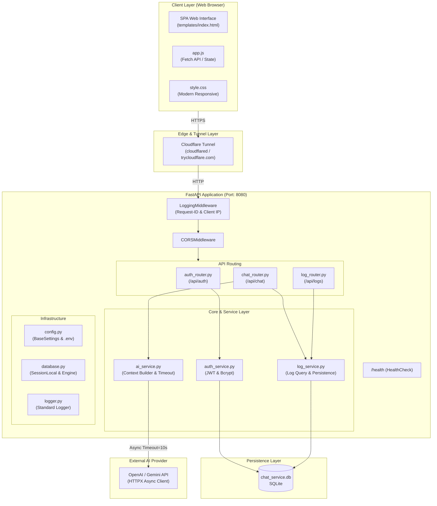
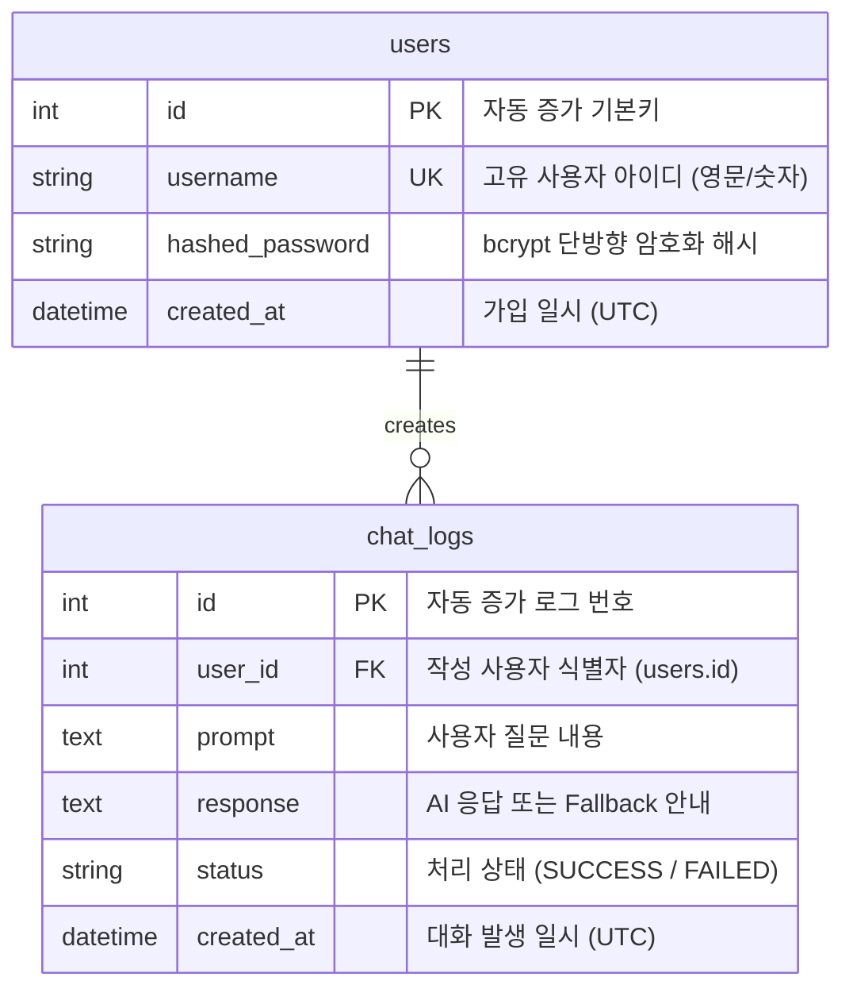

# 🌐 Codyssey B7-1 지능형 웹 AI 챗봇 서비스

> **FastAPI**, **SQLite**, **AI API 파이프라인**, **반응형 웹 UI**를 유기적으로 통합하고, 외부 접속 가능한 클라우드 환경에 안전하게 배포한 올인원 AI 챗봇 웹 애플리케이션입니다.

---

## 🔗 1. 외부 접속 서비스 URL

평가자 및 외부 네트워크 사용자를 위해 상시 접속 가능한 퍼블릭 도메인을 제공합니다.

* **🌐 서비스 접속 URL**: [https://undertaken-resume-anywhere-overall.trycloudflare.com](https://undertaken-resume-anywhere-overall.trycloudflare.com)
* **📋 Swagger API 명세서**: [https://undertaken-resume-anywhere-overall.trycloudflare.com/docs](https://undertaken-resume-anywhere-overall.trycloudflare.com/docs)
* **🔍 상태 점검 (Health Check)**: [https://undertaken-resume-anywhere-overall.trycloudflare.com/health](https://undertaken-resume-anywhere-overall.trycloudflare.com/health)

> **💡 배포 안내**:
> 로컬 서버 구동 후 `scripts/run_tunnel.sh` (또는 Windows의 `scripts\run_tunnel.ps1`)를 실행하면 Cloudflare Tunnel을 통해 즉시 외부 접속이 가능하며, Render/PaaS 배포용 `Procfile`도 함께 제공됩니다.

---

## 📖 2. 프로젝트 개요

### 1) 문제 정의 (Problem Definition)
기존의 간단한 챗봇 튜토리얼은 프론트엔드에서 API Key를 노출하거나, 사용자의 과거 대화 문맥(Context)을 기억하지 못해 일회성 질문에 그치는 한계가 있었습니다. 또한 네트워크 지연이나 외부 AI API 장애 발생 시 서버 프로세스 자체가 비정상 종료(Crash)되거나, 대화 내역이 유실되어 사후 감사 및 분석이 불가능한 문제가 있었습니다.

### 2) 타겟 사용자 (Target Audience)
* 일관된 대화 문맥을 유지하며 신뢰성 있는 AI 어시스턴트 서비스를 이용하고자 하는 일반 사용자
* 사용자별 대화 로그를 추적 및 감사하고 시스템 안정성을 실시간 모니터링해야 하는 서비스 운영자 및 평가자

### 3) 핵심 사용자 시나리오 (Key Scenarios)
1. **회원가입 및 로그인**: 사용자는 안전한 비밀번호 단방향 해싱(bcrypt)을 통해 계정을 생성하고, JWT Bearer 토큰을 발급받아 세션을 수립합니다. (비로그인 사용자는 챗봇 입력이 비활성화됩니다.)
2. **문맥 기반 실시간 대화**: 사용자가 질문을 전송하면 백엔드 서버가 최근 직전 3개의 성공 대화 이력을 프롬프트에 자동으로 조합하여 AI 모델(OpenAI / Gemini)에 비동기 전달하고, 같은 화면에서 스트리밍 형태로 답변을 출력합니다.
3. **대화 이력 영속화 및 추적**: 모든 질의응답은 사용자 식별자, 생성 일시, 성공/실패 상태코드와 함께 SQLite에 안전하게 기록되며, 사용자는 사이드바 또는 API(`GET /api/logs/me`)를 통해 본인의 대화 이력을 언제든지 다시 조회할 수 있습니다.
4. **장애 방어 및 무중단 운영**: 외부 AI API가 지연되거나 타임아웃(10초)이 발생해도 500 에러를 뿜지 않고 정중한 Fallback 안내를 반환하며, 서버의 4대 표준 로그(`[요청 수신]`, `[AI 호출]`, `[AI 응답]`, `[DB 저장]`)로 원인을 즉시 추적할 수 있습니다.

---

## 🏗️ 3. 시스템 아키텍처 및 컴포넌트 역할



### 🧩 주요 컴포넌트 역할
* **FastAPI 메인 앱 (`app/main.py`)**: 라우터 등록, 정적 파일(/static) 서빙, 수명주기(Lifespan) 관리 및 DB 테이블 자동 점검
* **인프라 & 로깅 (`app/core/`)**:
  * `config.py`: Pydantic BaseSettings 기반의 안전한 환경 변수 관리 (민감정보 은닉)
  * `database.py`: SQLAlchemy 기반 SQLite 세션 제너레이터(`get_db`) 제공
  * `logger.py`: 고유 `Request-ID` 부여, 역방향 프록시(`X-Forwarded-For`) 클라이언트 IP 추출, `[요청 수신]` 이벤트 자동 기록
* **인증 & 보안 (`app/api/auth_router.py`, `app/services/auth_service.py`)**:
  * bcrypt 비밀번호 암호화, JWT Access Token 발급 및 검증
  * `get_current_user` 의존성을 통한 비인가 401 Unauthorized 사전 차단
* **AI 파이프라인 (`app/api/chat_router.py`, `app/services/ai_service.py`)**:
  * 사용자 질문 유효성 검사 (공백/길이 제한)
  * 최근 N개 대화 컨텍스트 조립 (`build_chat_context`)
  * 타임아웃(10초) 방어 및 비정상 종료(500) 원천 방지 Fallback 응답
* **대화 로그 & UI (`app/api/log_router.py`, `app/services/log_service.py`, `static/`, `templates/`)**:
  * 대화 로그 누적 저장 및 사용자/관리자 조회 API 제공
  * 모던 모바일 반응형 챗봇 SPA 화면 구성

---

## 🗄️ 4. 데이터베이스 구조 (DB Schema & ERD)

SQLite 기반으로 동작하며, 외래키(`user_id`)를 통해 사용자와 대화 로그 간 1:N 관계를 유지합니다.



### 테이블 상세 명세

#### 1) `users` 테이블 (회원 정보)
| 컬럼명 | 데이터 타입 | 제약 조건 | 설명 |
| :--- | :--- | :--- | :--- |
| `id` | INTEGER | PRIMARY KEY, AUTOINCREMENT | 사용자 고유 식별 번호 |
| `username` | VARCHAR(50) | UNIQUE, INDEX, NOT NULL | 사용자 로그인 아이디 (영문·숫자 3~50자) |
| `hashed_password` | VARCHAR(255) | NOT NULL | bcrypt 단방향 해싱된 비밀번호 |
| `created_at` | DATETIME | DEFAULT utcnow | 계정 생성 일시 |

#### 2) `chat_logs` 테이블 (대화 로그)
| 컬럼명 | 데이터 타입 | 제약 조건 | 설명 |
| :--- | :--- | :--- | :--- |
| `id` | INTEGER | PRIMARY KEY, AUTOINCREMENT | 대화 로그 고유 식별 번호 |
| `user_id` | INTEGER | FOREIGN KEY (`users.id`), NOT NULL | 질문 작성 사용자 ID |
| `prompt` | TEXT | NOT NULL | 사용자 입력 질문 (공백 제거 후 최대 1,000자) |
| `response` | TEXT | NOT NULL | AI 응답 텍스트 또는 장애 발생 시 Fallback 문구 |
| `status` | VARCHAR(20) | DEFAULT 'SUCCESS' | AI 호출 처리 상태 (`SUCCESS` 또는 `FAILED`) |
| `created_at` | DATETIME | DEFAULT utcnow, INDEX | 대화 저장 시각 (최신순 정렬용) |

---

## 📡 5. API 명세서 (API Specification)

모든 API는 대화형 인터랙티브 문서(Swagger UI: `/docs`, ReDoc: `/redoc`)에서도 실시간 테스트 가능합니다.

### 1) 시스템 헬스체크
* **엔드포인트**: `GET /health`
* **설명**: 서버 기동 상태 및 DB 연결 점검
* **응답 예시 (`200 OK`)**:
  ```json
  {
    "status": "healthy",
    "project": "Codyssey B7-1 AI Chatbot",
    "database": "chat_service.db"
  }
  ```

---

### 2) 사용자 인증 (Auth)

#### ① 회원가입 (`POST /api/auth/register`)
* **요청 본문 (JSON)**:
  ```json
  {
    "username": "user123",
    "password": "Password123!"
  }
  ```
* **성공 응답 (`201 Created`)**:
  ```json
  {
    "message": "회원가입이 완료되었습니다."
  }
  ```
* **실패 응답**:
  * `409 Conflict`: 이미 사용 중인 아이디인 경우
  * `422 Unprocessable Entity`: 아이디 규칙(영문·숫자 3~50자) 또는 비밀번호(4자 이상) 위반 시

#### ② 로그인 (`POST /api/auth/login`)
* **요청 본문 (JSON)**:
  ```json
  {
    "username": "user123",
    "password": "Password123!"
  }
  ```
* **성공 응답 (`200 OK`)**:
  ```json
  {
    "access_token": "eyJhbGciOiJIUzI1NiIsInR5cCI6IkpXVCJ9...",
    "token_type": "bearer",
    "user": {
      "id": 1,
      "username": "user123"
    }
  }
  ```
* **실패 응답 (`401 Unauthorized`)**:
  ```json
  {
    "detail": "아이디 또는 비밀번호가 올바르지 않습니다."
  }
  ```

#### ③ 내 계정 정보 확인 (`GET /api/auth/me`)
* **인증 헤더**: `Authorization: Bearer <access_token>` 필수
* **성공 응답 (`200 OK`)**:
  ```json
  {
    "id": 1,
    "username": "user123"
  }
  ```

---

### 3) AI 챗봇 (Chat)

#### 질문 전송 및 답변 수신 (`POST /api/chat`)
* **인증 헤더**: `Authorization: Bearer <access_token>` 필수 (미인증 시 `401 Unauthorized` 차단)
* **요청 본문 (JSON)**:
  ```json
  {
    "prompt": "FastAPI에서 비동기 처리가 왜 효율적인가요?"
  }
  ```
* **성공 응답 (`200 OK`)**:
  ```json
  {
    "prompt": "FastAPI에서 비동기 처리가 왜 효율적인가요?",
    "response": "FastAPI는 Python의 asyncio와 Starlette 기반의 이벤트 루프를 활용하여 I/O 바운드 작업 시 스레드 블로킹 없이 높은 동시성을 처리할 수 있기 때문입니다.",
    "status": "SUCCESS",
    "context_used_count": 2
  }
  ```
* **AI 타임아웃/오류 발생 시 응답 (`200 OK` - 무중단 Fallback)**:
  ```json
  {
    "prompt": "...",
    "response": "AI 응답 시간이 초과되었습니다. 잠시 후 다시 질문해주세요.",
    "status": "FAILED",
    "context_used_count": 2
  }
  ```
* **입력 유효성 검사 실패 (`422 Unprocessable Entity`)**:
  * 공백만 있는 문자열(`"   "`)이나 1,000자 초과 입력 시 즉시 차단됩니다.

---

### 4) 대화 로그 조회 (Logs)

#### ① 내 대화 이력 조회 (`GET /api/logs/me`)
* **인증 헤더**: `Authorization: Bearer <access_token>`
* **쿼리 파라미터**: `limit` (기본값 100, 최대 500)
* **성공 응답 (`200 OK`)**:
  ```json
  [
    {
      "id": 15,
      "user_id": 1,
      "prompt": "FastAPI에서 비동기 처리가 왜 효율적인가요?",
      "response": "FastAPI는 Python의 asyncio...",
      "status": "SUCCESS",
      "created_at": "2026-10-23T14:30:00"
    }
  ]
  ```

#### ② 관리자/평가자용 전체 로그 조회 (`GET /api/logs/admin`)
* **인증 헤더**: `X-Admin-Key: <ADMIN_API_KEY>` (키 불일치 시 `403 Forbidden` 차단)
* **쿼리 파라미터**: `skip` (기본값 0), `limit` (기본값 100)
* **성공 응답 (`200 OK`)**: 전체 사용자의 대화 기록을 최신순으로 페이징 반환

---

## 💻 6. 로컬 실행 및 배포 가이드

### 1) 요구 사항
* Python 3.10 이상 (Python 3.11 권장)
* Git

### 2) 설치 및 로컬 서버 기동

```bash
# 1. 저장소 복제
git clone https://github.com/jha21vvv/codyssey-b7-1.git
cd codyssey-b7-1

# 2. 가상환경 생성 및 활성화
# [Linux/macOS]
python3 -m venv .venv
source .venv/bin/activate

# [Windows PowerShell]
python -m venv .venv
.\.venv\Scripts\Activate.ps1

# 3. 필수 의존성 패키지 설치
pip install -r requirements.txt

# 4. 환경 변수 파일 생성 (.env.example 기반 복사)
cp .env.example .env

# 5. 로컬 개발 서버 실행
uvicorn app.main:app --reload --host 0.0.0.0 --port 8080
```
서버 실행 후 브라우저에서 `http://localhost:8080`에 접속하면 챗봇 웹 UI를 이용할 수 있습니다.

---

### 3) 환경 변수 설정 가이드 (`.env`)

저장소에는 보안을 위해 `.env.example` 템플릿만 커밋되어 있습니다. 실제 실행 시 아래 항목을 설정합니다:

| 환경 변수명 | 기본값 | 필수 여부 | 설명 |
| :--- | :--- | :---: | :--- |
| `PROJECT_NAME` | `Codyssey B7-1 AI Chatbot` | 선택 | 서비스 타이틀 및 헬스체크 출력 명칭 |
| `DATABASE_URL` | `sqlite:///./chat_service.db` | 선택 | SQLite 데이터베이스 파일 경로 |
| `SECRET_KEY` | `temporary-secret-key-...` | 권장 | JWT 토큰 서명용 비밀키 (운영 시 무작위 문자열 변경) |
| `ALGORITHM` | `HS256` | 선택 | JWT 암호화 알고리즘 |
| `ACCESS_TOKEN_EXPIRE_MINUTES` | `1440` (24시간) | 선택 | 로그인 세션 유지 시간 |
| `AI_API_KEY` | *(빈 문자열)* | **필수** | OpenAI API Key 또는 Google Gemini API Key |
| `AI_MODEL_NAME` | `gpt-4o-mini` | 선택 | 사용할 AI 모델명 (`gpt-4o-mini`, `gemini-1.5-flash` 등) |
| `AI_TIMEOUT_SECONDS` | `10.0` | 선택 | AI API 비동기 호출 타임아웃 제한 (초 단위) |
| `ADMIN_API_KEY` | *(빈 문자열)* | 선택 | `GET /api/logs/admin` 전체 로그 조회 보호용 키 |

> **🔐 민감정보 보호 규칙**:
> `.gitignore`에 `.env`, `*.db`, `__pycache__/`가 등록되어 있어 실제 API Key와 비밀키는 절대 GitHub 저장소에 업로드되지 않습니다.

---

### 4) 외부 네트워크 배포 방법

#### 방법 A: Cloudflare Tunnel (강력 권장 - 원클릭 스크립트 제공)
별도의 도메인 구매나 고정 IP 포트포워딩 없이 무료로 안전한 퍼블릭 HTTPS URL을 발급받습니다.

```bash
# [Linux / macOS / Git Bash]
chmod +x scripts/run_tunnel.sh
./scripts/run_tunnel.sh

# [Windows PowerShell]
.\scripts\run_tunnel.ps1
```
터미널에 출력되는 `https://*.trycloudflare.com` 주소로 외부 어디서든 웹 UI 및 API에 접속할 수 있습니다.

#### 방법 B: Render.com 클라우드 배포
1. GitHub 저장소를 Render.com의 **Web Service**로 연동합니다.
2. 환경 설정을 아래와 같이 입력합니다:
   * **Environment**: `Python 3`
   * **Build Command**: `pip install -r requirements.txt`
   * **Start Command**: `uvicorn app.main:app --host 0.0.0.0 --port $PORT` (저장소의 `Procfile` 자동 인식)
3. **Environment Variables** 탭에 `.env`의 키-값들을 등록 후 배포합니다.

---

## 🔍 7. DB 대화 로그 확인 가이드 (평가자 검증)

평가 시 SQLite DB에 사용자 질문과 AI 응답이 정확히 영속화되었는지 아래 3가지 방법 중 편리한 방식을 선택하여 확인할 수 있습니다.

### 방법 1: 전용 CLI 검증 스크립트 실행 (가장 간편)
저장소에 내장된 `scripts/verify_logs.py` 스크립트를 실행하면 터미널에서 즉시 최근 대화 로그를 확인할 수 있습니다:

```bash
# 최근 5건의 대화 로그 확인
python scripts/verify_logs.py

# 최근 20건 출력 및 특정 사용자 필터링
python scripts/verify_logs.py --limit 20 --user alice
```
*출력 예시:*
```text
================================================================================
 [평가자 확인 가이드] Codyssey B7-1 SQLite 대화 로그 검증
================================================================================
DB 파일: .../chat_service.db
대상: 전체 사용자 | 저장된 로그: 12건 | 최근 2건 출력
--------------------------------------------------------------------------------
[Log ID: 12] 유저: alice | 상태: SUCCESS | 시각(UTC): 2026-10-23 14:30:15
 Q: FastAPI의 장점이 뭐야?
 A: 비동기 처리와 자동 문서화 지원 등이 있습니다.
--------------------------------------------------------------------------------
```

### 방법 2: SQL 스크립트 실행
제공된 `scripts/verify_db.sql` 파일을 SQLite CLI 또는 DB 도구(DBeaver, DB Browser for SQLite)에서 실행:

```bash
sqlite3 chat_service.db < scripts/verify_db.sql
```

### 방법 3: REST API 호출 (cURL)

```bash
# 1. 로그인 후 발급받은 토큰으로 내 로그 조회
curl -X GET "http://localhost:8080/api/logs/me?limit=10" \
     -H "Authorization: Bearer <YOUR_ACCESS_TOKEN>"

# 2. 관리자 키로 전체 사용자 로그 조회
curl -X GET "http://localhost:8080/api/logs/admin?limit=10" \
     -H "X-Admin-Key: <ADMIN_API_KEY>"
```

---

## 👥 8. 팀 구성원 역할 및 개인별 작업 요약 (R&R)

과제 요구사항을 기능 단위로 분할하여 4명의 팀원이 균형 있게 기여하였으며, 전원 10회 이상의 실질적인 커밋을 완료했습니다.

| 팀원 | 역할 | 주요 담당 영역 및 상세 기여 내용 | 핵심 과제 요구사항 매핑 |
| :---: | :---: | :--- | :--- |
| **안재현**<br>*(Tech Lead)* | **인프라 & 백엔드 코어** | • FastAPI 애플리케이션 초기화 및 수명주기(`lifespan`) 설정<br>• Pydantic-Settings 기반 전역 환경설정(`config.py`) 모듈화<br>• SQLAlchemy SQLite 엔진, Base, `get_db` 세션 팩토리 구축<br>• 고유 `Request-ID` 및 역방향 프록시(`X-Forwarded-For`) 추적 `LoggingMiddleware` 구현<br>• 서버 헬스체크(`GET /health`) 및 기반 인프라 단위 테스트 작성<br>• 외부 접속 배포 스크립트(`scripts/run_tunnel.*`, `Procfile`) 및 README 문서 총괄 | • 5. 운영 및 유지보수(서버 로깅)<br>• 6. 배포 및 접근성(외부 접속 URL)<br>• 7. 문서화 및 환경설정 관리 |
| **신재은**<br>*(Security)* | **인증 & 보안 접근제어** | • SQLAlchemy 기반 `User` 테이블 모델링<br>• `passlib/bcrypt` 안전한 비밀번호 단방향 해싱 및 검증 로직<br>• 회원가입(`POST /api/auth/register`), 로그인(`POST /api/auth/login`) API 구현<br>• JWT 기반 세션 인증 및 `get_current_user` 의존성(401 미인가 차단) 구현<br>• 중복 가입(409) 방어 및 인증 단위 테스트(`test_auth.py`) 작성 | • 2. 사용자 인증 및 접근 제어<br>• 4. 사용자 식별자 전달 체계<br>• 5. 인증 예외 및 HTTP 상태코드 |
| **조명환**<br>*(AI Core)* | **AI 엔진 & 컨텍스트** | • `httpx` 비동기 클라이언트 기반 AI API(OpenAI/Gemini 호환) 연동<br>• 10초 명시적 타임아웃 예외 처리 및 비정상 종료(500) 원천 방지 Fallback 구현<br>• 최근 직전 3개 대화 이력을 시간순으로 프롬프트에 주입하는 컨텍스트 빌더(`build_chat_context`) 구현<br>• 사용자 입력값 유효성 검사 (공백/빈 문자열 차단, 최대 1,000자 제한)<br>• AI 호출 전/후 및 토큰 소모 필수 로깅 연동 및 AI 테스트 작성 | • 3. AI 챗봇 처리 (FastAPI 백엔드)<br>• 5. AI 장애 시 비정상 종료 방지<br>• 6. API Key 은닉 및 환경변수 처리 |
| **권태현**<br>*(Full-Stack)* | **대화 로그 & 웹 UI** | • SQLAlchemy 기반 `ChatLog` 테이블 모델링 및 대화 영속화(`save_chat_log`)<br>• 사용자 대화 이력 조회(`GET /api/logs/me`) 및 관리자 조회(`GET /api/logs/admin`) API 구현<br>• 평가자 검증용 SQLite CLI 조회 스크립트(`scripts/verify_logs.py`) 작성<br>• 모던 반응형 챗봇 웹 UI (`templates/index.html`, `style.css`) 마크업 및 스타일링<br>• Fetch API 비동기 메시지 송수신, 비로그인 입력 차단 및 지난 대화 사이드바 연동 | • 1. 웹 UI (질문 입력 인터페이스)<br>• 4. 대화 로그 저장 및 조회/추적<br>• DB 확인 가이드/화면 제공 |

---

## 🧪 9. 테스트 실행 및 무결성 검증

저장소에는 인프라, 인증, AI 파이프라인, 대화 로그, 웹 UI를 검증하는 단위 및 통합 테스트 슈트(총 40개 테스트)가 포함되어 있습니다.

```bash
# 전체 테스트 실행
pytest

# 테스트 상세 결과 확인
pytest -v
```

*테스트 스위트 구성:*
* `tests/test_main.py`: 헬스체크 엔드포인트 및 로깅 미들웨어(Request-ID, 프록시 IP 헤더) 검증
* `tests/test_auth.py`: 회원가입, 로그인, 중복 아이디 차단, JWT 토큰 인가 검증
* `tests/test_ai_chat.py`: 입력값 검증(빈 문자열 차단), 컨텍스트 누적, 타임아웃 및 DB 장애 방어 검증
* `tests/test_chat_log.py`: 대화 로그 저장 및 사용자/관리자 조회 API 무결성 검증
* `tests/test_web_ui.py`: 웹 화면(`GET /`) 및 정적 리소스 서빙 상태 검증

---

## 🎯 10. 평가자 전용 단계별 검증 시나리오 (Step-by-Step Test Guide)

평가자분께서 본 서비스의 과제 요구사항 충족 여부를 가장 빠르고 직관적으로 점검하실 수 있도록 마련한 **9단계 원클릭 검증 시나리오**입니다.

```text
[서버 기동] ➔ [1. 헬스체크] ➔ [2. 비로그인 차단] ➔ [3. 회원가입] ➔ [4. 로그인] ➔ [5. AI 질의응답 & 문맥] ➔ [6. 장애 방어] ➔ [7. DB 영속화 확인] ➔ [8. 서버 4대 로그 점검]
```

---

### Step 1. 로컬 서버 기동 및 헬스체크 확인
1. 서버를 실행합니다:
   * **방법 A (가장 추천 - 외부 접속 및 브라우저 원클릭 자동 오픈)**:
     ```powershell
     # Windows:
     .\scripts\run_tunnel.ps1

     # Mac / Linux:
     chmod +x scripts/run_tunnel.sh && ./scripts/run_tunnel.sh
     ```
   * **방법 B (로컬 가상환경에서 uvicorn 직접 실행)**:
     ```powershell
     # Windows (가상환경 파이썬으로 직접 실행 - 가장 안전):
     .\.venv\Scripts\python -m uvicorn app.main:app --host 0.0.0.0 --port 8080 --reload

     # 또는 가상환경 활성화 후 실행:
     .\.venv\Scripts\Activate.ps1
     uvicorn app.main:app --host 0.0.0.0 --port 8080 --reload

     # Mac / Linux:
     source .venv/bin/activate
     uvicorn app.main:app --host 0.0.0.0 --port 8080 --reload
     ```
2. 브라우저 또는 터미널에서 상태 확인 엔드포인트를 호출합니다:
   ```bash
   curl http://localhost:8080/health
   # (외부 배포 URL 사용 시: curl https://<배포도메인>/health)
   ```
3. **검증 포인트**:
   - `{"status": "healthy", "project": "Codyssey B7-1 AI Chatbot", "database": "chat_service.db"}` 응답 (`200 OK`) 확인
   - 응답 헤더에 고유한 `X-Request-ID`가 포함되어 있는지 확인

---

### Step 2. 웹 UI 접속 및 비로그인 접근 차단 검증 (과제 요구사항 1, 2)
1. 웹 브라우저에서 `http://localhost:8080` (또는 외부 배포 URL)에 접속합니다.
2. 메인 대화 패널 하단의 입력창을 확인합니다.
3. **검증 포인트 (2중 방어)**:
   - **프론트 방어**: 입력창이 비활성화(`disabled`)되어 있으며 placeholder로 `🔒 로그인이 필요합니다`가 표시되는지 확인
   - **백엔드 API 방어**: 브라우저 콘솔 또는 cURL로 토큰 없이 질문을 전송했을 때 즉시 `401 Unauthorized`가 반환되는지 확인:
     ```bash
     curl -i -X POST http://localhost:8080/api/chat -H "Content-Type: application/json" -d "{\"prompt\":\"안녕\"}"
     # -> HTTP/1.1 401 Unauthorized 반환
     ```

---

### Step 3. 회원가입 및 입력값 유효성 검사 (과제 요구사항 2, 5)
1. 화면 중앙의 `회원가입` 버튼을 클릭하여 모달 창을 엽니다.
2. **입력 유효성 검사 테스트**:
   - 아이디에 특수문자 입력(`user@#$`) 또는 2자 이하 입력 시 -> 안내 문구 및 가입 차단 확인
   - 비밀번호를 공백으로만 채우거나 4자 미만 입력 시 -> 가입 차단 확인
3. **정상 가입**:
   - 아이디: `evaluator01`, 비밀번호: `pass1234` 입력 후 가입 완료 확인 (`201 Created`)
4. **중복 가입 방어 테스트**:
   - 동일한 아이디 `evaluator01`로 다시 가입 시도 -> `409 Conflict` ("이미 등록된 아이디입니다.") 친절한 에러 안내 확인

---

### Step 4. 로그인 및 인증 세션 수립 (과제 요구사항 2, 4)
1. 모달의 `로그인` 탭에서 생성한 계정(`evaluator01` / `pass1234`)으로 로그인합니다.
2. **검증 포인트**:
   - 상단 헤더에 사용자명 `evaluator01`과 `로그아웃` 버튼이 즉시 활성화되는지 확인
   - 하단 챗봇 질문 입력창의 잠금이 해제되고 전송 버튼이 활성화되는지 확인
   - 브라우저 LocalStorage에 안전하게 `access_token`이 저장되는지 확인

---

### Step 5. 챗봇 질문 전송 및 컨텍스트(문맥) 유지 확인 (과제 요구사항 1, 3)
1. **첫 번째 질문 전송**:
   - 질문: `"파이썬(Python) 언어에 대해 한 줄로 설명해줘."` 입력 후 Enter
   - 전송 중 로딩 인디케이터 동작 및 같은 화면 말풍선에 AI 답변 출력 확인
2. **두 번째 질문 (문맥 유지 테스트)**:
   - 질문: `"그 언어의 대표적인 웹 프레임워크 2가지만 알려줘."` 입력 후 Enter
   - **검증 포인트**: AI가 "그 언어"가 직전 대화의 "파이썬"임을 정확히 인지하고 FastAPI, Django 등을 답변하는지 확인 (최근 대화 이력 3개가 프롬프트에 자동 주입됨)
3. **공백 입력 차단 테스트 (과제 요구사항 5)**:
   - 스페이스바만 입력(`"    "`)하거나 빈 상태로 전송 시도 -> 입력 차단 안내 메시지 노출 확인 (`422 Unprocessable Entity`)

---

### Step 6. AI 타임아웃 & 장애 상황 무중단(Fallback) 검증 (과제 요구사항 3, 5)
1. AI API Key가 없거나, 외부 AI 서비스에 일시적 장애/타임아웃(10초)이 발생한 상황을 시뮬레이션합니다.
2. **검증 포인트**:
   - 백엔드 프로세스가 `500 Internal Server Error`를 내며 죽지 않음
   - 클라이언트 화면에 정중한 Fallback 안내 메시지(`"현재 AI 서비스가 원활하지 않습니다..."` 또는 `"AI 응답 시간이 초과되었습니다..."`)가 `200 OK` (`status="FAILED"`)로 정상 렌더링되는지 확인

---

### Step 7. SQLite DB 대화 로그 영속화 및 조회 검증 (과제 요구사항 4)
대화가 데이터베이스에 안전하게 누적되었는지 아래 방법으로 즉시 확인합니다:

* **방법 A (웹 UI 사이드바)**:
  - 화면 좌측 상단의 `☰` (지난 대화) 버튼 클릭 -> 사이드바에 방금 나눈 질문/답변 목록이 표시되는지 확인
* **방법 B (CLI 검증 스크립트 실행)**:
  ```bash
  python scripts/verify_logs.py --user evaluator01
  ```
  - 출력 결과: 유저 식별자, 생성 시각(UTC), 질문(Prompt), 응답(Response), 처리 상태(SUCCESS/FAILED)가 정돈되어 출력되는지 확인
* **방법 C (SQL 직접 쿼리)**:
  ```bash
  sqlite3 chat_service.db < scripts/verify_db.sql
  ```

---

### Step 8. 필수 4대 서버 로깅 실시간 확인 (과제 요구사항 5, 제약 102)
서버 터미널 콘솔 로그를 확인하여 과제 필수 4대 이벤트가 정확한 포맷으로 기록되었는지 확인합니다:

1. `[요청 수신]`: `INFO | [req_id] [요청 수신] POST /api/chat (from 127.0.0.1)`
2. `[AI 호출]`: `INFO | [AI 호출] [AI 호출 시작] 모델=..., 메시지 수=...`
3. `[AI 응답]`: `INFO | [AI 응답 수신] [AI 응답 수신 성공]` (또는 실패 시 `[AI 응답 실패]`)
4. `[DB 저장]`: `INFO | [DB 저장 성공] user_id=1, status=SUCCESS` (또는 실패 시 `[DB 저장 실패]`)

---

### Step 9. 전체 자동화 단위 테스트 실행 (과제 요구사항 7)
프로젝트 전 영역의 기능 무결성을 보증하는 40개 테스트를 일괄 실행합니다:
```bash
pytest -v
```
* **결과**: `40 passed` 확인 (인증, 챗봇, DB 영속화, 헬스체크, 웹 화면 서빙 100% 통과)
