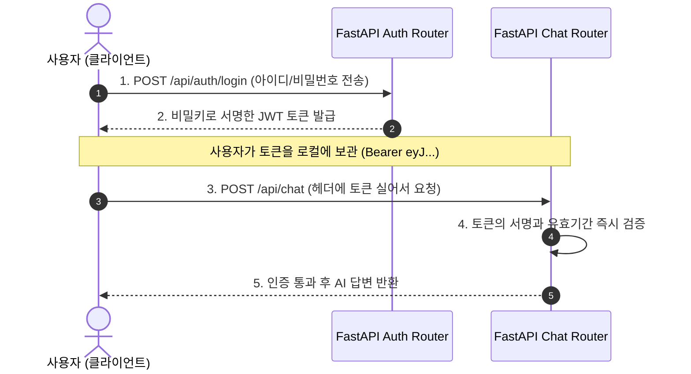

# 📚 [안재현 전담 백엔드 & 인프라 핵심 개념 문답 정리집]

> **작성 목적**: 백엔드 코어 설계 및 인프라 구현 과정에서 헷갈리기 쉬운 핵심 질문 5가지에 대한 **직관적인 비유, 실무 코드 예시, 10초 요약** 정리본입니다.  
> **활용처**: 개인 학습, 기술 면접 구술 대비, 팀 내 지식 공유용

---

## 🧭 목차
1. [Q1. 싱글톤(Singleton)과 .env 중앙화의 명확한 차이](#q1-싱글톤singleton과-env-중앙화의-명확한-차이)
2. [Q2. SQLite 멀티스레드 충돌(`check_same_thread=False`)과 DB 세션 누수 방지(`yield`)](#q2-sqlite-멀티스레드-충돌check_same_threadfalse과-db-세션-누수-방지yield)
3. [Q3. JWT(JSON Web Token) 로그인의 원리와 동작 방식](#q3-jwtjson-web-token-로그인의-원리와-동작-방식)
4. [Q4. FastAPI 라우터 연동과 VPC 라우팅 테이블의 비교](#q4-fastapi-라우터-연동과-vpc-라우팅-테이블의-비교)
5. [Q5. 라이프스팬(Lifespan) 컨텍스트 매니저의 개념과 필요성](#q5-라이프스팬lifespan-컨텍스트-매니저의-개념과-필요성)

---

## Q1. 싱글톤(Singleton)과 .env 중앙화의 명확한 차이

### ❓ 질문
> *"싱글톤 자체가 .env에 관련 키들을 다 저장해 두는 거야? .env 한 개에 다 몰아넣는 게 싱글톤인가?"*

### 💡 핵심 답변: 아닙니다! 둘은 완전히 다른 영역의 이야기입니다.
* **중앙화 (Centralization)**: 설정을 여기저기 흩어놓지 않고 **`.env` 파일 1개에 모아두는 저장소 정리 방식**입니다.
* **싱글톤 (Singleton)**: 그 설정을 파이썬 코드로 읽어온 뒤, **메모리(RAM)에 객체를 딱 1개만 만들어 돌려쓰는 프로그래밍 디자인 패턴**입니다.

### 1. 역할 분담 표 (비유로 이해하기)
| 구분 | 위치 | 하는 일 | 일상 비유 |
| :--- | :--- | :--- | :--- |
| **`.env` 파일** | 하드디스크 (저장소) | API 키, DB 주소 등을 적어둔 비밀 파일 | **사물함에 적어둔 비밀 장부** |
| **Pydantic `Settings`** | 코드 (클래스) | `.env` 장부를 열어 타입을 검증하고 파이썬 객체로 변환 | **장부를 읽고 검사하는 직원** |
| **싱글톤 (`settings`)** | 메모리 (RAM) | 직원이 만든 결과물 객체를 **딱 1개만 메모리에 올려두고 공유** | **회사에 1명만 두는 총무 담당자** |

### 2. 붕어빵 비유로 이해하는 싱글톤
* `Settings` 클래스 = **붕어빵 틀**
* `Settings()` 객체 = **붕어빵**

#### ❌ 싱글톤을 쓰지 않을 때 (요청마다 새 객체 생성)
```python
# auth.py에서
setting1 = Settings()  # 붕어빵 1개 새로 굽고 하드디스크 .env 읽음

# chat.py에서
setting2 = Settings()  # 붕어빵 또 굽고 하드디스크 .env 또 읽음

# database.py에서
setting3 = Settings()  # 붕어빵 또 굽고 하드디스크 .env 또 읽음
```
* **문제점**: 요청이 들어올 때마다 느린 하드디스크 파일을 계속 읽어서 시스템 리소스(CPU, 메모리, I/O)가 낭비됩니다.

#### ⭕ 싱글톤을 쓸 때 (`app/core/config.py`)
```python
# config.py 맨 아래에서 서버 켤 때 딱 1개만 미리 구워둠
settings = Settings()
```
```python
# 다른 모든 파일(auth.py, chat.py, database.py)에서:
from app.core.config import settings  # 이미 메모리에 구워진 '그 1개'를 공유해서 사용!
```
* **장점**: 디스크 I/O가 단 1회로 끝나며, 전역에서 동일한 설정 상태를 완벽히 공유합니다.

> 📢 **10초 요약**:  
> `.env` 하나에 모으는 것은 **파일 중앙화**,  
> 그 파일 내용을 읽은 파이썬 객체를 **메모리에 딱 1개만 만들어 재사용하는 것**이 **싱글톤 패턴**입니다.

---

## Q2. SQLite 멀티스레드 충돌(`check_same_thread=False`)과 DB 세션 누수 방지(`yield`)

### ❓ 질문
> *"FastAPI는 고성능을 내려고 여러 스레드를 넘나드는데 SQLite는 단일 스레드만 허용해서 충돌? `check_same_thread=False`로 해결? DB 세션을 닫아줘서 커넥션 누수를 해결한다는 게 무슨 말이야?"*

---

### 1편: `check_same_thread = False`의 원리

#### 📌 일꾼(스레드)과 깐깐한 금고지기(SQLite)
* **스레드(Thread)**: 식당에서 일하는 **'주방 직원(일꾼)'**입니다.
* **FastAPI**: 주문이 몰리면 음식을 빨리 빼기 위해 **여러 일꾼(직원 A, 직원 B, 직원 C...)**을 동시에 마구 돌립니다. (멀티스레드)
* **SQLite 기본 규칙**: 
  > *"직원 A가 금고(DB) 문을 열었으면, 끝까지 직원 A만 돈을 꺼내야 해! 직원 B가 손대면 파업(에러)할 거야!"*
* **충돌 상황**:  
  FastAPI는 주문을 받을 땐 **직원 A**가 처리하다가, 도중에 바빠지면 **직원 B**에게 DB 작업을 넘깁니다.  
  이때 SQLite가 *"넌 직원 A가 아닌데 왜 만져?!"* 하고 뻗어버립니다 (`SQLite objects created in a thread...` 에러).
* **해결 (`connect_args={"check_same_thread": False}`)**:  
  > *"SQLite야 안심해. 우리 식당 정직원들이니까 **직원 A가 만든 연결 통로를 B나 C가 건드려도 에러 내지 말고 통과시켜(False)!**"*  
  라고 규칙을 완화해 준 것입니다.

---

### 2편: 세션 닫기와 커넥션 누수(Connection Leak) 방지

#### 📌 전화 통화와 통화 중 먹통
* DB와 대화하려면 **'전화 연결(DB 세션)'**을 걸어야 합니다.
* DB는 동시에 받을 수 있는 전화 회선 수(커넥션 풀)가 한정되어 있습니다 (예: 10회선).
* **문제 상황 (커넥션 누수)**:  
  손님이 "내 정보 조회해줘" 해서 직원이 DB에 전화를 걸었습니다. 그런데 조회 도중 에러가 났거나, 깜빡하고 **전화를 안 끊고 퇴근해 버렸습니다.**
  * 손님 10명이 지나가면 10개 회선이 전부 통화 중(먹통)이 됩니다.
  * 11번째 손님부터는 전화를 걸 수 없어 **서버 전체가 멈춰버립니다.**

#### 📌 `yield get_db()`가 해결한 방식
```python
def get_db():
    db = SessionLocal()  # 1. DB에 전화 걸기
    try:
        yield db         # 2. 전화기를 API 핸들러에게 잠깐 빌려줘서 작업하게 함
    finally:
        db.close()       # 3. 작업 성공이든 치명적 에러든 상관없이 무조건 100% 전화를 끊음!
```
* **`yield`**: "잠깐 빌려줄 테니 다 쓰고 돌려줘!"
* **`finally: db.close()`**: 무슨 일이 있어도 전화를 탁 끊어주므로 회선이 고갈되지 않습니다.

> 📢 **10초 요약**:  
> 1. **`check_same_thread=False`**: FastAPI의 여러 일꾼(스레드)이 하나의 SQLite 통로를 에러 없이 같이 쓰게 해주는 설정.  
> 2. **`yield get_db()`**: 작업 후(에러가 나도) 전화를 확실히 끊어주어(`db.close()`) DB 연결 통로가 마르는 참사(누수)를 막는 안전장치.

---

## Q3. JWT(JSON Web Token) 로그인의 원리와 동작 방식

### ❓ 질문
> *"JWT 로그인이 뭐야?"*

### 💡 핵심 답변: "위조 불가능한 모바일 자유이용권 팔찌"입니다.

### 1. 세션 방식(옛날) vs JWT 방식(최신) 비교
| 구분 | 옛날 세션(Session) 로그인 | 최신 JWT(Token) 로그인 |
| :--- | :--- | :--- |
| **비유** | 놀이공원 **'출입 명부 장부'** | 위조 방지 도장이 찍힌 **'자유이용권 팔찌'** |
| **서버 동작** | 로그인할 때마다 서버 장부(DB/RAM)에 손님 번호를 적어둠 | 서버 장부에 안 적고, 손님에게 암호 도장 찍힌 팔찌를 쥐여줌 |
| **검증 방식** | 손님이 올 때마다 서버 장부를 일일이 뒤져서 대조 | 손님이 내민 팔찌의 **'도장과 유효기간'**만 눈으로 쓱 확인 |
| **서버 부하** | 손님이 100만 명이면 **장부가 무거워져 서버 다운** | 서버가 저장할 게 없어서 **100만 명이 와도 끄떡없음 (Stateless)** |

### 2. JWT 토큰의 3단 구조
JWT 토큰은 마침표(`.`)로 연결된 세 덩어리 문자열입니다:
```text
Header(헤더).Payload(내용).Signature(서명)
eyJhbGciOi... . eyJzdWIiOi... . TJVA95OrM7...
```
1. **헤더(Header)**: 어떤 알고리즘(HS256 등)으로 도장을 찍었는가?
2. **내용(Payload)**: 누구인가? 유효기간은 언제까지인가? (이름, 이메일, 권한 등)
3. **서명(Signature)**: 서버만 가진 비밀키(`SECRET_KEY`)로 찍은 위조 방지 도장.
   * **주의**: Payload는 누구나 읽을 수 있으므로 비밀번호는 절대 넣지 않습니다.
   * **위조 불가**: 손님이 Payload를 `"관리자"`로 변조하면 서버의 서명 검증에서 즉시 탈락합니다.

### 3. 우리 프로젝트 적용 흐름 (신재은 팀원 Auth 파트)


> 📢 **10초 요약**:  
> JWT는 서버가 로그인 상태를 일일이 기억하는 대신,  
> 사용자에게 **위조 불가능한 암호화 도장이 찍힌 신분증(토큰)**을 주고 매 요청마다 검사하는 **가볍고 빠른 인증 방식**입니다.

---

## Q4. FastAPI 라우터 연동과 VPC 라우팅 테이블의 비교

### ❓ 질문
> *"메인에 팀원들의 라우터를 끼워 넣는다는데, 이게 유저 요구에 따라 갈 길을 안내하는 VPC 라우팅 테이블 같은 건가?"*

### 💡 핵심 답변: 네, 정확합니다! 인프라의 VPC 라우팅 테이블과 원리가 100% 동일합니다.

### 1. VPC 라우팅 테이블 vs FastAPI 메인 라우터 비교
| 구분 | 클라우드 VPC 라우팅 테이블 (네트워크) | FastAPI `main.py` 라우터 (애플리케이션) |
| :--- | :--- | :--- |
| **안내 기준** | 패킷의 **목적지 IP 대역 (CIDR)** | HTTP 요청의 **목적지 URL 경로 (Prefix)** |
| **중심 안내소** | VPC 라우터 (Router) | **`app/main.py`** |
| **전달 목적지** | 특정 서브넷 / 인스턴스 | **각 팀원이 작성한 Router 함수** |

### 2. 코드로 보는 1:1 매칭
* **VPC 라우팅 테이블**:
  * `10.0.1.0/24` ➡️ 서브넷 A (인증 서버)
  * `10.0.2.0/24` ➡️ 서브넷 B (AI 서버)
  * `10.0.3.0/24` ➡️ 서브넷 C (로그 서버)

* **FastAPI `app/main.py` 라우팅 테이블**:
```python
# [안재현 테크 리드가 작성한 main.py의 라우팅 테이블]

# 1. URL이 "/api/auth"로 시작하면? ➡️ 신재은 팀원의 auth_router로 보낸다!
app.include_router(auth_router, prefix="/api/auth", tags=["Auth"])

# 2. URL이 "/api/chat"으로 시작하면? ➡️ 조명환 팀원의 chat_router로 보낸다!
app.include_router(chat_router, prefix="/api/chat", tags=["Chat"])

# 3. URL이 "/api/logs"로 시작하면? ➡️ 권태현 팀원의 log_router로 보낸다!
app.include_router(log_router, prefix="/api/logs", tags=["Logs"])
```

### 3. 라우터를 분리해 끼워 넣는 이유 (협업 관점)
* 만약 라우터 분리가 없다면, 모든 팀원이 `main.py` 한 파일에 수천 줄의 코드를 동시에 작성하다가 **깃(Git) 충돌**이 폭발합니다.
* 각 팀원은 자기 파일(`auth_router.py`, `chat_router.py`, `log_router.py`)에서 독립적으로 개발하고,
* **테크 리드(안재현)**는 `main.py`라는 허브에서 **"교통 안내 표지판(`app.include_router`)"**만 꽂아주어 완벽한 협업 환경을 구축했습니다.

> 📢 **10초 요약**:  
> VPC 라우팅 테이블이 목적지 IP를 보고 패킷을 보내주듯,  
> `main.py`는 **요청된 URL 주소(`/api/auth`, `/api/chat` 등)를 보고 담당 팀원의 코드로 트래픽을 안내하는 길잡이 표지판**입니다.

---

## Q5. 라이프스팬(Lifespan) 컨텍스트 매니저의 개념과 필요성

### ❓ 질문
> *"라이프스팬 컨텍스트 매니저가 뭐야?"*

### 💡 핵심 답변: "서버가 태어나서(시작) 죽을 때까지(종료)의 인생 주기 관리자"입니다.

### 1. 식당 비유로 보는 3단계 구조
* **1단계 오픈 전 (서버 기동)**: 식자재 점검, 가스 불 켜기, 테이블 닦기
* **2단계 영업 중 (`yield`)**: 손님 맞이, 주문 및 조리 처리
* **3단계 마감 후 (서버 종료)**: 가스 밸브 잠그기, 쓰레기 정리, 문 잠그기

### 2. 실제 코드 동작 (`app/main.py`)
```python
@asynccontextmanager
async def lifespan(app: FastAPI):
    # -------------------------------------------------------------
    # [1단계: 서버 켜질 때 딱 1번 실행] - 오픈 준비
    # -------------------------------------------------------------
    logger.info("애플리케이션 시작 중... DB 테이블 점검")
    Base.metadata.create_all(bind=engine)  # 🚨 DB 테이블 자동 생성
    logger.info("DB 초기화 완료")

    yield  # ------------------------------------------------------
           # [2단계: yield 순간 멈추고 서버가 손님 요청을 처리함]
           # ------------------------------------------------------

    # -------------------------------------------------------------
    # [3단계: 서버 끌 때 딱 1번 실행] - 마감 뒷정리
    # -------------------------------------------------------------
    logger.info("애플리케이션 종료")
```

### 3. '컨텍스트 매니저'란 무엇이며 왜 쓰는가?
* 파이썬에서 `with` 문처럼 **"어떤 방에 들어갈 때 준비하고, 나갈 때 알아서 뒷정리해 주는 도구"**를 컨텍스트 매니저라고 합니다.
* `@asynccontextmanager` 데코레이터를 붙이면, 함수 안에 **`yield` 하나만 찍어두면** 앞부분은 시작할 때, 뒷부분은 끝날 때 알아서 실행됩니다.

### 4. 구버전(`on_event`)과의 차이점
* **과거 방식**:
  ```python
  @app.on_event("startup")   # 시작 함수 따로
  @app.on_event("shutdown")  # 종료 함수 따로
  ```
  * 코드가 파편화되고 예외 발생 시 안전한 종료 처리가 어려워 최신 FastAPI에서는 **폐기(Deprecated) 권고**되었습니다.
* **최신 방식 (`lifespan`)**:
  * 시작과 종료를 하나의 함수 안에서 안전하고 유기적으로 관리하는 **현재 FastAPI의 공식 표준 방식**입니다.

> 📢 **10초 요약**:  
> 라이프스팬 컨텍스트 매니저는 서버가 켜질 때 **DB 테이블 같은 기초 작업을 자동으로 수행하고**,  
> 서버가 꺼질 때는 **남은 자원을 깔끔하게 뒷정리해 주는 서버의 생애주기 관리자**입니다.
